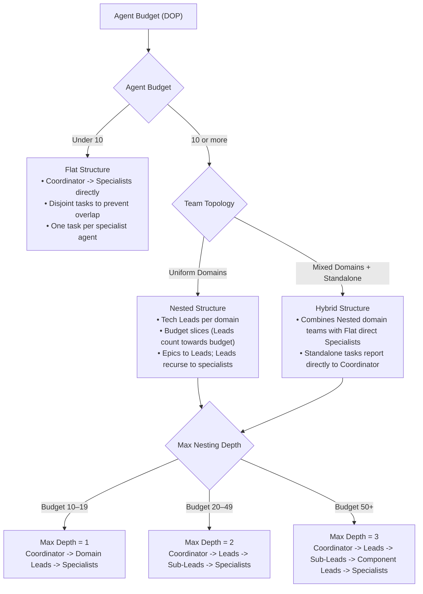
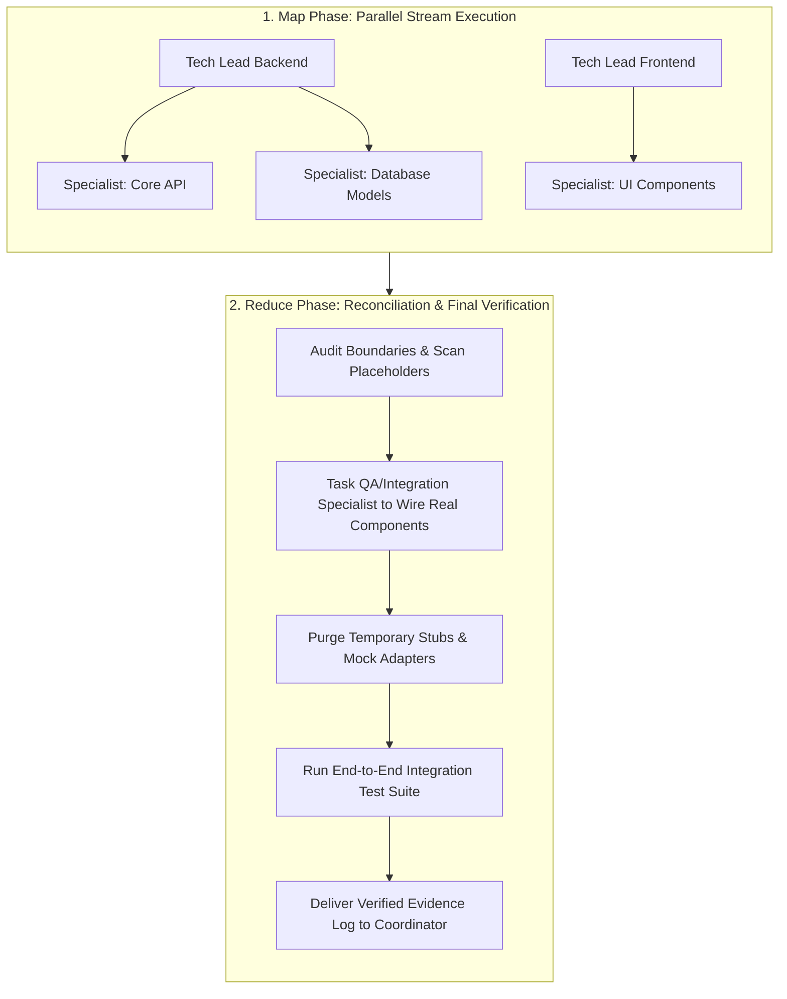
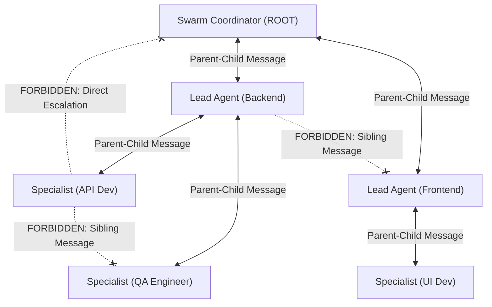

# Swarm Coding

Swarm Coding divides complex engineering objectives among multiple specialized subagents structured in a clear hierarchical organization chart. This divide-and-conquer strategy guarantees context isolation, prevents cross-domain pollution, and accelerates execution by keeping subagent tasks narrowly scoped.

> [!NOTE]
> In this guide, the terms "agent" and "subagent" are used interchangeably.

---

## ⚡ Core Principles & Operational Rules

1. **Mandatory Activation:** Activate this skill immediately on any mention of the word "swarm" (case-insensitive) in relation to planning or executing a task.
2. **Coordinator Persistence & Non-Execution:**
   - The ROOT Swarm Coordinator ALWAYS remains a coordinator and NEVER falls back to an executor.
   - The Swarm Coordinator is strictly forbidden from writing production implementation code, running tests/builds, or performing direct command execution.
3. **Split Coordinator Profiles:**
   - **Swarm Coordinator (ROOT):** Attributed strictly to the ROOT agent that activated the skill (Multiplicity: 1). Defines the top-level **Org Chart**, names Lead Agents, allocates the agent budget, writes top-level architecture specs, and coordinates overall progress.
   - **Lead Agent:** Attributed to domain or system leads (Multiplicity: N, one per system/domain). Receives an allocated sub-budget from the Swarm Coordinator, assembles a specialist team, writes domain specifications, delegates tasks, and integrates domain deliverables.
4. **Specialist Role:** Attributed to task executors. Designs and implements narrowly-scoped components within a single domain, adhering to domain specs and running operational validation loops.
5. **Strict Communication Hierarchy (No Lateral Messaging):**
   - **Allowed:** Messaging between immediate parents and children ONLY (Swarm Coordinator <-> Lead Agent, Lead Agent <-> Specialist; or Swarm Coordinator <-> Specialist in flat/hybrid structures).
   - **Forbidden:** Direct communication between agents on the SAME layer (Lead Agent <-> Lead Agent, Specialist <-> Specialist) or direct escalation (Specialist <-> Swarm Coordinator bypassing an intermediate Lead Agent) is strictly forbidden.
   - **Design Document First:** Inter-domain or cross-layer coordination MUST be handled by writing or updating shared design documents first, then notifying parent/child agents via hierarchical messaging.
6. **Fine-Grained Targeted Testing (No Broad Root Sweeps):** Specialists MUST execute fine-grained, package-scoped unit tests (e.g., `go test ./internal/physics/...`) strictly targeting their assigned task. Running broad project-root test commands (e.g., `go test ./...`) is strictly forbidden for Specialists unless explicitly requested by the Swarm Coordinator, preventing cross-task contamination and false failures while parallel agents work concurrently.
7. **Swarm Awareness Propagation (Zero Ambient Knowledge):**
   - Subagents are spawned with blank context and have **zero ambient understanding** of swarm protocols, DOP mechanics, non-execution posture, or boundary isolation.
   - Merely stating *"you are a swarm coding agent"* or *"you have a budget of X"* is strictly insufficient and forbidden as a standalone instruction.
   - **Coordinator -> Lead Propagation**: The Coordinator MUST explicitly define the Lead's system role (non-executing architect), equip it with `commandExecutionPolicy: off` (never `run_command`), preserve customizations (`inheritCustomizations: true`), and provide an operational briefing detailing its exact budget arithmetic (1 slot for lead, DOP - 1 concurrent workers, slot recycling, and backlog drip-feeding).
   - **Lead -> Specialist Propagation**: The Lead MUST explicitly define the Specialist's scope (strict file boundaries, localized test commands only, fail-fast without fallbacks, evidence-based reporting, and immediate termination to free concurrency slots).

---

## 🎯 Agent Budget & Degree of Parallelism (DOP)

* **Definition**: **Agent Budget** is synonymous with **Degree of Parallelism (DOP)**. It defines the maximum number of **active, concurrent subagents** allowed to execute at the exact same time across the entire swarm hierarchy.
* **Budget Arithmetic & Slot Accounting**:
  - `Domain Budget (DOP) = 1 (Lead Agent) + N (Concurrent Specialists)`.
  - The Lead Agent consumes 1 concurrency slot. For example, if a Lead is allocated a budget slice of 8, it occupies 1 slot and can run up to **7 concurrent Specialists** simultaneously.
* **Active vs. Past Capacity (Slot Recycling)**: Completed or terminated subagents do **not** consume budget. The budget applies strictly to currently running subagents. When a subagent completes its work and terminates, its concurrency slot is immediately freed.
* **Backlog Drip-Feeding**: When domain tasks exceed available specialist slots ($N$), the Lead Agent maintains a domain task backlog and drip-feeds tasks to fresh Specialists as prior workers conclude.
* **Default Concurrency**: Assumes a default budget of **10** active concurrent agents if omitted by the user.
* **Low Budget Guard (<= 1):** If the user specifies an `agent budget <= 1`, multi-agent orchestration is disabled. Automatically fall back to direct single-agent execution without spawning subagents, notifying the user: *"Agent budget is set to <= 1; running in direct single-agent execution mode. To enable swarm parallelism, specify an agent budget > 1 (default: 10)."*
* **Swarm Shapes (Flat, Nested, Hybrid)**:
  - **Flat**: Swarm Coordinator coordinates Specialists directly (no intermediate Tech Leads). Used when agent budget < 10.
  - **Nested**: Swarm Coordinator assigns Tech Leads per domain and allocates each a slice of the agent budget. Leads recursively break down epics into specialist tasks. Used when agent budget >= 10.
  - **Hybrid**: Combines nested domain teams with flat direct specialists reporting to the Coordinator for standalone or cross-cutting tasks.

### 🌲 Swarm Sizing Decision Tree



#### Decision Rules:

1. **Agent Budget < 10 -> Flat Structure**:
   - Coordinator coordinates Specialists directly (all specialists, no intermediate Tech Leads).
   - Break down tasks so that agents do not step on each other, and assign one task to each agent.
2. **Agent Budget >= 10 -> Nested Structure**:
   - Assign Tech Leads per domain and give them a slice of the agent budget (**Tech Leads also count towards the budget**).
   - Break down the task into "epics" and give them to the Leads.
   - Leads recursively break down epics into granular tasks for specialists (or subordinate leads).
   - **Nesting Level (Max Depth below Coordinator)**:
     - **Budget < 20** (10-19): `max depth == 1` (Coordinator -> Domain Tech Leads -> Specialists).
     - **Budget between 20 and 49**: `max depth == 2` (Coordinator -> Domain Tech Leads -> Sub-Leads -> Specialists).
     - **Budget >= 50** (or > 50): `max depth == 3` (Coordinator -> Domain Tech Leads -> Sub-Leads -> Component Leads -> Specialists).
     > [!NOTE]
     > The tree does not need to be perfectly balanced; different branches can have different depths based on domain complexity.
3. **Hybrid Structure (Mixed Workloads)**:
   - Use when an initiative contains both complex multi-agent domains requiring Tech Leads and focused, standalone, or cross-cutting tasks (e.g., dedicated QA/Integration, architecture spike, or isolated single-task component) that report directly to the Swarm Coordinator without an intermediate Tech Lead.
   - Nested branches follow the depth rules above, while direct specialists consume 1 concurrency slot each.

---

## 📡 Non-Blocking Coordinator & Reactive Concurrency

The Swarm Coordinator is the primary user interface and top-level organizational conductor. It must remain **unblocked >= 99% of the time** to receive steering comments, scope modifications, and status requests from the user.

1. **Role Separation (Delegation over Execution):**
   - The Swarm Coordinator acts like an engineering director: it breaks down epics, writes top-level architectural contracts, and manages the org chart. It **never** blocks itself with sequential coding, manual building, or terminal test runs.
2. **Fire-and-Yield Concurrency:**
   - When the Coordinator spawns Lead Agents via `invoke_subagent`, it **immediately halts tool calls to end its turn**. It never loops, sleeps, or polls.
3. **Always Unblocked for User Steering & Status Inquiries:**
   - Because the Coordinator never enters busy-wait polling loops, it is permanently available to process incoming user messages while the swarm works in the background:
     - **Status Inquiries**: The Coordinator can immediately provide live progress updates or inspect active workers via `manage_subagents (Action="list")`.
     - **In-Flight Steering / Scope Changes**: If the user provides new constraints or changes requirements mid-run, the Coordinator can steer active Lead Agents via `send_message` or cancel/restart them via `manage_subagents (Action="kill")`.
4. **Sole User Escalation Interface:**
   - Subagents do not possess `ask_question`. All requirement ambiguities or design trade-offs encountered by Specialists are messaged up to their Tech Lead, who routes them to the Swarm Coordinator via `send_message`. The Coordinator prompts the user with `ask_question` and relays decisions back down the hierarchy.

---

## 🔄 Map-Reduce Workflow & The "Reduce" (Reconciliation) Step

Swarm Coding operates as a two-stage **Map-Reduce** engineering pipeline:



### 1. Map Phase (Parallel Development & Collision Avoidance)
* **Flexible Subagent Prompting**: Provide clear domain goals and target boundaries in prompts without brittle syntax constraints.
* **Tech Lead Arbitration**: Team Leads dynamically arbitrate file boundaries and dependencies among their specialists as changes evolve.
* **Temporary Interface Contracts**: When Specialist A depends on in-progress work from Specialist B, they program against agreed interface stubs or mocks.

### 2. The Final "Reduce" Phase (Integration & Placeholder Purge)
Parallel execution often leaves behind temporary mocks or stubs where real implementations were created by peer agents. Before declaring success, the Coordinator orchestrates the final **Reduce** step:

1. **Placeholder & Stub Audit**: Scans code boundaries to ensure no dangling `TODO` comments, dummy return values, or temporary mock adapters survive.
2. **Reconciliation & Real Component Wiring**: The Coordinator tasks a designated **Integration/QA Specialist** to connect all real modules together.
3. **End-to-End Project Verification**: The QA Specialist runs full project builds, integration tests, and linters, reporting actual terminal proof back to the Coordinator before final delivery to the user.

---

## 👥 Mechanics and Roles

Subagents in a Swarm Coding session assume one of three roles:

1. **Swarm Coordinator (ROOT)** [Multiplicity: 1]
   - Acts as top-level architect and organizational manager.
   - Defines the **Org Chart**, names Lead Agents for each domain, allocates agent budgets, and writes top-level architecture specs.
   - **Persistence & Non-Execution:** Strictly forbidden from executing code or running build/test commands.
   - **Sole User Interface:** Sole agent in the swarm authorized to interact with the user via `ask_question`.
2. **Lead Agent (Domain Tech Lead)** [Multiplicity: N]
   - Technical lead for a specific domain or system (e.g., Frontend, Backend, Database).
   - Assembles a Specialist team within their allocated sub-budget, writes domain specs ("Design Document First"), deconstructs domain tasks, arbitrates collisions, and integrates deliverables.
   - **Tool Restrictions:** Command/script execution is disabled (`commandExecutionPolicy: off`). Delegates execution to Specialists and routes user questions up to the Swarm Coordinator via `send_message`.
3. **Specialist (Task Implementer / QA)** [Multiplicity: N]
   - Ephemeral and task-scoped (disposable worker). Operates with a clean, focused context window dedicated strictly to its assigned task.
   - Follows domain specifications, executes the operational validation loop (build, test, lint, format), replaces stubs, and provides proof-of-validation logs to their parent Lead Agent, then completes.

### 🛠️ Modern Subagent Configuration & Inheritance

When defining subagents (`agent.md` or via `define_subagent`), adhere to modern Antigravity configuration standards:
* **Customization & Skill Inheritance (`inheritCustomizations: true`)**:
  Subagents MUST declare `inheritCustomizations: true`. This ensures the subagent seamlessly adopts all parent and workspace customizations (skills like `kungfu` and domain linters, rules, plugins, and custom configurations) without synchronization drift. Setting this to false strips the subagent of project rules and capabilities.
* **MCP Integration (`inheritMcp: true`)**:
  Passes through external MCP tool servers (e.g., database tools, devtools, knowledge servers) so subagents have access to necessary development tools.
* **Model Configuration (`model: inherit`)**:
  Always use `inherit` (in agent definitions and `invoke_subagent`). Subagents automatically adopt the parent session's model configuration and reasoning effort (`/effort`), ensuring complete behavioral consistency across the swarm hierarchy without model-routing overhead.
* **Execution Boundary & Tool Assignment (`commandExecutionPolicy`)**:
  - **Lead Agents**: MUST have `commandExecutionPolicy: off`. When defining tools for a Lead, **NEVER include `run_command`**. Lead Agents are strictly prohibited from compiling, executing scripts, or running terminal commands.
  - **Specialists**: MUST have `commandExecutionPolicy: sandbox`. Equipped with file and terminal execution tools (`run_command`), but delegation tools (`define_subagent`, `invoke_subagent`, `manage_subagents`) and user prompting (`ask_question`) are strictly disabled.

---

## 📋 Swarm Briefing Protocols & Canonical Prompt Templates

Subagents start with blank conversational context. Simply telling an agent *"you are a swarm coding agent"* or *"you have a budget of 8"* provides zero understanding of swarm protocols, DOP mechanics, non-execution posture, or boundary isolation. Coordinators and Leads must feed complete definitions and structured initial briefings.

### 1. Coordinator -> Lead Agent Briefing Protocol

When the Swarm Coordinator spawns a Lead Agent via `invoke_subagent` (referencing `assets/agents/lead-agent.md` or defined via `define_subagent`), the Coordinator MUST supply a prompt conforming to this structure:

```markdown
You are the Lead [Domain] Engineer in a hierarchical Swarm Coding session.

### Role & Execution Boundary (Strict Non-Execution)
You are an architect, planner, and manager for your domain. You are strictly forbidden from writing production code or running terminal commands yourself. All implementation, package installations, and validation runs MUST be delegated to Specialist subagents.

### Agent Budget & Concurrency Mechanics (DOP: [N])
- Your allocated domain budget is [N] concurrent agents.
- You occupy 1 concurrency slot, leaving [N - 1] active concurrent Specialist slots.
- Concurrency slots are ephemeral and freed immediately when a Specialist finishes and exits.
- If your epic has more tasks than [N - 1], maintain a domain task backlog and drip-feed tasks to new Specialists as prior workers conclude.

### Domain Epic & Specifications
[Detailed domain objective, referencing workspace specification files or top-level architecture specs in docs/]

### Your Swarm Protocol
1. Specification First: Draft or update domain API/data contracts before assigning tasks.
2. Task Deconstruction: Break the epic into independent, non-overlapping tasks with disjoint file boundaries.
3. Spawn & Steer Specialists: Define/invoke Specialist workers (model: inherit, commandExecutionPolicy: sandbox). Supply each with explicit file boundaries, localized test commands, and fail-fast rules.
4. Domain Reconciliation: Verify that Specialists replace all temporary stubs/mocks with real implementations, review validation logs, and message completion to your parent (Swarm Coordinator).
5. User Escalation: You do not have ask_question. Send any requirement ambiguities to the Swarm Coordinator via send_message.
```

### 2. Lead Agent -> Specialist Briefing Protocol

When a Lead Agent spawns a Specialist via `invoke_subagent` (referencing `assets/agents/specialist-agent.md`), the Lead MUST provide a prompt conforming to this structure:

```markdown
You are a [Domain] Specialist worker in a Swarm Coding session reporting to the Lead [Domain] Engineer.

### Assigned Scope & File Boundaries
- Task: [Explicit description of the granular task]
- Target Files: [Explicit list of allowed files to create/edit]
- Forbidden Boundaries: Do NOT touch files outside your assigned list. If you depend on contracts from other modules, use the agreed interfaces in [spec path].

### Execution & Validation Rules
1. Scoped Validation: Run ONLY localized package/file tests (e.g., `npm test path/to/test` or `go test ./pkg/...`). NEVER run full-repository root commands like `npm test` or `go test ./...` which pollute other concurrent workers.
2. Fail Fast & No Fallbacks: Never introduce fallback mechanisms, mock modes for live data, or silent error suppression. Always fail fast with rich diagnostics.
3. Proof & Completion: Once implementation passes tests and linters, send your terminal validation output to your parent (Lead [Domain] Engineer) via send_message, then terminate to release your concurrency slot.
```

---

## 💬 Communication Hierarchy & Rules



1. **Vertical Parent-Child Messaging ONLY:**
   - Swarm Coordinator <-> Lead Agent
   - Lead Agent <-> Specialist
2. **Forbidden Lateral Communication:**
   - Communication between agents on the SAME layer (Lead <-> Lead, Specialist <-> Specialist) is strictly forbidden.
   - Specialists MUST NOT message the Swarm Coordinator directly.
3. **Specification-Driven Coordination ("Design Document First"):**
   - When a change in Domain A impacts Domain B, Lead Agent A updates the shared design document in the workspace, then messages the Swarm Coordinator. The Swarm Coordinator reviews and notifies Lead Agent B.

---

## ⚠️ Gotchas & Antipatterns

1. **The Ambient Swarm Assumption Trap:** Assuming spawned subagents inherently understand they are in a swarm or know what "budget" means. Without injecting system definitions and using the canonical briefing templates, subagents will act like solo coders.
2. **The Lead-As-Coder Prompting Trap:** Prompting a Lead Agent with individual coding commands ("Install library X, implement function Y, verify endpoints") instead of an epic and delegation instructions. This directly causes the Lead to act as an executor.
3. **The Lead Executor Toolset Trap:** Equipping a Lead Agent with `run_command` or setting `commandExecutionPolicy` to anything other than `off`. If a Lead Agent has terminal execution tools, it will bypass its team and code itself.
4. **The Customization Stripping Trap:** Setting `inheritCustomizations: false` or `inheritMcp: false` on subagents. This strips away project rules (fail-fast, no fallbacks), linters, and the `kungfu` gateway.
5. **The Coordinator-to-Executor Fallback Trap:** Once activated, the Swarm Coordinator MUST NOT interpret user follow-up messages as permission to write code or execute tasks directly. Treat all messages as requests *to the swarm*.
6. **Leftover Placeholder Trap:** Delivering code where temporary stubs or mocks survive into the final codebase. Always execute the Reduce phase to purge stubs and wire real implementations.
7. **Under-Utilization Mismatch:** Spawning too few agents or failing to utilize Lead Agents when the agent budget and task scope allow multi-tier delegation. Always build a sensible Org Chart when budget >= 10.
8. **Sibling Messaging Trap:** Attempting to send direct messages between peer Lead Agents or peer Specialists. Always route cross-component updates through shared design documents and hierarchical parent-child messages.
9. **The Long-Running Agent Context-Pollution Trap:** Retaining subagents indefinitely across multiple distinct tasks accumulates noisy tool logs, failed attempts, and token bloat. Specialists should be disposable and task-scoped—spawn fresh workers with clean context windows per task for maximum precision and speed.
10. **The Root Test Contamination Trap:** Running broad project-root test commands (e.g., `go test ./...`) while parallel agents are modifying other packages causes false test failures. Specialists must scope test commands strictly to their assigned package until the final Reduce step.
11. **Passive Polling Loops:** Coordinator and Lead agents must never poll subagent statuses in a tight loop; rely on automatic reactive wakeup upon subagent task completion.

---

## 📚 Progressive Disclosure & References

- **Swarm Coordinator Reference**: [`references/coordinator.md`](references/coordinator.md) — Root coordinator responsibilities, org chart design, unblocked posture, and the Reduce step.
- **Lead Agent Reference**: [`references/lead.md`](references/lead.md) — Domain tech lead responsibilities, dynamic collision arbitration, and sub-team management.
- **Specialist Reference**: [`references/specialist.md`](references/specialist.md) — Task execution, operational validation loop, stub replacement, and proof-of-correctness reporting.
- **Bundled Lead Agent Template**: [`assets/agents/lead-agent.md`](assets/agents/lead-agent.md) — Standard subagent definition for domain leads.
- **Bundled Specialist Agent Template**: [`assets/agents/specialist-agent.md`](assets/agents/specialist-agent.md) — Standard subagent definition for specialist workers.
