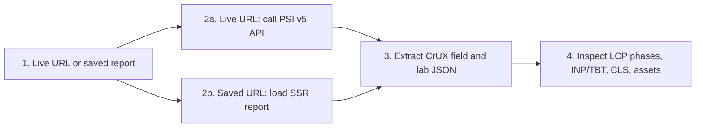

# Run PageSpeed Insights audits

Static page fetches (`curl` or `fetch` on HTML) fail on [PageSpeed Insights](https://pagespeed.web.dev/) while a browser run executes, and full DOM snapshots (`take_snapshot`) waste tokens while hiding byte-level diagnostics.

Use two clean JSON paths instead:
- **Path A (CLI REST API)**: Query the PageSpeed Insights `v5` REST endpoint (`runPagespeed`) directly from the terminal for any public live URL.
- **Path B (Browser SSR variables)**: Read `window.__LIGHTHOUSE_MOBILE_JSON__` and `window.__LIGHTHOUSE_DESKTOP_JSON__` in one script evaluation on `pagespeed.web.dev` report URLs.

---

## Core concepts and rules

### 1. Pick REST API for live URLs and SSR variables for saved reports
- **Rule**: Call the `v5` REST API (`runPagespeed`) for live URL audits in headless CLI workflows. Use SSR `window.__LIGHTHOUSE_MOBILE_JSON__` and `window.__LIGHTHOUSE_DESKTOP_JSON__` variables when the user shares a `pagespeed.web.dev/analysis/...` report link or when auditing inside a browser session.
- **Why it holds**: Server-side rendering (`SSR`) on `pagespeed.web.dev` embeds both Mobile and Desktop JSON payloads onto `window` during permalink load, while the `v5` REST API returns identical Lighthouse (`LHR`) and `CrUX` JSON directly over HTTP without browser tabs.
- **What it forbids**: Never call `take_snapshot` to scrape PageSpeed Insights scores or click UI tabs to inspect the second device form factor.

### 2. Reload the server-rendered report URL before reading variables
- **Rule**: When starting a browser audit on `/analysis?url=...`, wait (`15 to 30 seconds`, bounded to `90 seconds` max) for the address bar to update to `/analysis/<domain-slug>/<report-id>`, then run a full navigation (`navigate_page`) to that report URL before reading `window.__LIGHTHOUSE_*_JSON__`.
- **Why it holds**: When an interactive run finishes, the single-page app (`SPA`) updates the URL with `history.pushState` and renders from client memory. The server only writes `window.__LIGHTHOUSE_MOBILE_JSON__` and `window.__LIGHTHOUSE_DESKTOP_JSON__` on a fresh `SSR` document request.
- **What it forbids**: Never poll indefinitely past `90 seconds`, and never attempt to bypass an anti-bot or `CAPTCHA` gate; stop and report upstream error banners or access blocks directly.

### 3. Separate CrUX field Core Web Vitals from lab proxies
- **Rule**: Inspect both `CrUX` real-user 28-day `p75` field metrics (`LCP`, `INP`, and `CLS` inside `loadingExperience` and `originLoadingExperience`) and Lighthouse lab diagnostics. Split every `LCP` (`Largest Contentful Paint`) issue into its four phases (`timeToFirstByte`, `resourceLoadDelay`, `resourceLoadDuration`, `elementRenderDelay`) from `lcp-breakdown-insight` before changing code.
- **Why it holds**: `INP` (`Interaction to Next Paint`) is a Core Web Vital measured in field `CrUX` data, whereas synthetic lab runs report `TBT` (`Total Blocking Time`) as its main-thread proxy alongside `FCP` and Speed Index (`SI`). Shrinking an image file only lowers `resourceLoadDuration`, doing nothing when late discovery (`resourceLoadDelay`) or script work (`elementRenderDelay`) drives `LCP`.
- **What it forbids**: Never re-encode images or tune caching before confirming whether `resourceLoadDuration` or `timeToFirstByte` dominates `LCP`.

### 4. Match image dimensions to the painted CSS box
- **Rule**: Supply responsive `srcset` and `sizes` variants so delivered pixel dimensions match the painted CSS box (`boundingRect.width * dpr`).
- **Why it holds**: `image-delivery-insight` flags `wastedBytes` whenever intrinsic image dimensions (`naturalWidth * naturalHeight`) overshoot the rendered CSS box. Using `object-fit: cover` is fine when paired with explicit `width` and `height` attributes and responsive image candidates close to the rendered box; leaving `sizes="100vw"` on multi-column grids forces browsers to fetch oversized files.
- **What it forbids**: Never ship full-resolution source files relying solely on `object-fit: cover` to crop them down, and never set `loading="lazy"` or `decoding="async"` on the hero `LCP` image.

### 5. Keep pre-LCP network and main-thread work minimal
- **Rule**: Keep the pre-`LCP` window clear of blocking stylesheets, sync scripts, non-critical `fetch` or `XHR` requests, and forced layout reads after DOM writes.
- **Why it holds**: Background requests compete for connections and trigger extra `CORS` preflight `OPTIONS` hops when using non-simple headers like `Content-Type: application/json`, while sync scripts and layout thrashing delay painting even after bytes arrive (`elementRenderDelay`) and degrade `TBT` and `INP`.
- **What it forbids**: Never trigger analytics hydration bursts before `window.load` and `requestAnimationFrame`, and never read `offsetWidth` or `getBoundingClientRect` right after DOM mutations during initial load.

---

## End-to-end workflow



### Path A: Query the PageSpeed Insights v5 REST API (CLI)

Run `mobile` and `desktop` audits from any shell with `curl` and `jq` (set `PAGESPEED_API_KEY` for higher quota, or omit it for unauthenticated calls within standard limits):

```bash
set -euo pipefail

TARGET_URL="https://example.com/"
ENCODED_URL=$(python3 -c 'import sys, urllib.parse; print(urllib.parse.quote(sys.argv[1], safe=""))' "$TARGET_URL")

for strategy in mobile desktop; do
  API_URL="https://www.googleapis.com/pagespeedonline/v5/runPagespeed?url=${ENCODED_URL}&strategy=${strategy}&category=performance&category=accessibility&category=best-practices&category=seo${PAGESPEED_API_KEY:+&key=${PAGESPEED_API_KEY}}"

  echo "=== Strategy: $strategy ==="
  curl -fsSL --max-time 90 "$API_URL" | jq '{
    strategy: "'"$strategy"'",
    final_url: .lighthouseResult.finalDisplayedUrl,
    crux_overall: .loadingExperience.overall_category,
    crux_p75: {
      LCP_ms: .loadingExperience.metrics.LARGEST_CONTENTFUL_PAINT_MS.percentile,
      INP_ms: .loadingExperience.metrics.INTERACTION_TO_NEXT_PAINT.percentile,
      CLS: .loadingExperience.metrics.CUMULATIVE_LAYOUT_SHIFT_SCORE.percentile,
      FCP_ms: .loadingExperience.metrics.FIRST_CONTENTFUL_PAINT_MS.percentile,
      TTFB_ms: .loadingExperience.metrics.EXPERIMENTAL_TIME_TO_FIRST_BYTE.percentile
    },
    origin_crux_overall: .originLoadingExperience.overall_category,
    scores: (.lighthouseResult.categories | to_entries | map({
      key,
      value: (if .value.score == null then null else ((.value.score * 100) | round) end)
    }) | from_entries),
    lab_metrics: {
      FCP: .lighthouseResult.audits["first-contentful-paint"].displayValue,
      LCP: .lighthouseResult.audits["largest-contentful-paint"].displayValue,
      TBT: .lighthouseResult.audits["total-blocking-time"].displayValue,
      CLS: .lighthouseResult.audits["cumulative-layout-shift"].displayValue,
      SI:  .lighthouseResult.audits["speed-index"].displayValue
    },
    failing_audits: [
      .lighthouseResult.audits | to_entries[]
      | select(.value.score != null and .value.score < 1 and .value.scoreDisplayMode != "informative")
      | {id: .key, title: .value.title, score: .value.score, displayValue: .value.displayValue}
    ]
  }'
done
```

### Path B: Read SSR variables from `pagespeed.web.dev`

Use browser automation tools (`navigate_page`, `evaluate_script`, `new_page`, `list_pages`) when inspecting shared `pagespeed.web.dev` report URLs:

1. **Saved report URL** (`https://pagespeed.web.dev/analysis/<domain-slug>/<report-id>`): Open directly and extract data right away.
2. **Start a live browser audit**: Open `https://pagespeed.web.dev/analysis?url=https%3A%2F%2Fexample.com%2F`, then wait (`15 to 30 seconds`, `90 seconds` max timeout) until `window.location.pathname` matches `/^\/analysis\/[^/]+\/[^/]+/` (stopping right away if the page displays an error alert or anti-bot gate).
3. **Reload the permalink**: Call `navigate_page` on the exact `window.location.href` permalink so the server injects `window.__LIGHTHOUSE_MOBILE_JSON__` and `window.__LIGHTHOUSE_DESKTOP_JSON__`.

#### Extract CrUX field metrics and lab scorecard

Run this script on the reloaded permalink (it throws an error instead of returning silent nulls when `SSR` variables are absent):

```javascript
() => {
  const mRaw = window.__LIGHTHOUSE_MOBILE_JSON__;
  const dRaw = window.__LIGHTHOUSE_DESKTOP_JSON__;
  if (!mRaw && !dRaw) {
    throw new Error(
      'Missing window.__LIGHTHOUSE_*_JSON__: reload the /analysis/<slug>/<id> URL from the server first.'
    );
  }

  const pickCrux = (exp) => {
    if (!exp) return null;
    const m = exp.metrics || {};
    return {
      overallCategory: exp.overall_category || null,
      p75: {
        LCP_ms: m.LARGEST_CONTENTFUL_PAINT_MS?.percentile ?? null,
        INP_ms: m.INTERACTION_TO_NEXT_PAINT?.percentile ?? null,
        CLS: m.CUMULATIVE_LAYOUT_SHIFT_SCORE?.percentile ?? null,
        FCP_ms: m.FIRST_CONTENTFUL_PAINT_MS?.percentile ?? null,
        TTFB_ms: m.EXPERIMENTAL_TIME_TO_FIRST_BYTE?.percentile ?? null,
      },
    };
  };

  const extractSummary = (raw) => {
    if (!raw) return null;
    const lhr = raw.lighthouseResult || raw;
    if (!lhr || !lhr.categories) {
      throw new Error('Invalid LHR structure on SSR global: missing categories.');
    }
    const scores = Object.fromEntries(
      Object.entries(lhr.categories).map(([k, v]) => [
        k,
        v.score === null || v.score === undefined ? null : Math.round(v.score * 100),
      ])
    );
    const labMetrics = {
      FCP: lhr.audits['first-contentful-paint']?.displayValue ?? null,
      LCP: lhr.audits['largest-contentful-paint']?.displayValue ?? null,
      TBT: lhr.audits['total-blocking-time']?.displayValue ?? null,
      CLS: lhr.audits['cumulative-layout-shift']?.displayValue ?? null,
      SI:  lhr.audits['speed-index']?.displayValue ?? null,
    };
    const failingAudits = Object.entries(lhr.audits)
      .filter(([, a]) => a.score !== null && a.score < 1 && a.scoreDisplayMode !== 'informative')
      .map(([id, a]) => ({
        id,
        title: a.title,
        score: a.score,
        displayValue: a.displayValue,
      }));
    return {
      fetchTime: lhr.fetchTime,
      cruxField: pickCrux(raw.loadingExperience),
      originCruxField: pickCrux(raw.originLoadingExperience),
      scores,
      labMetrics,
      failingAudits,
    };
  };

  return {
    url: window.location.href,
    mobile: extractSummary(mRaw),
    desktop: extractSummary(dRaw),
  };
}
```

#### Inspect failing lab audits in depth

Query failing audit keys on `window.__LIGHTHOUSE_MOBILE_JSON__` or `window.__LIGHTHOUSE_DESKTOP_JSON__` to inspect selectors, asset URLs, wasted bytes, and source stack frames:

```javascript
() => {
  const raw = window.__LIGHTHOUSE_MOBILE_JSON__;
  const lhr = raw?.lighthouseResult || raw;
  if (!lhr || !lhr.audits) {
    throw new Error('Missing window.__LIGHTHOUSE_MOBILE_JSON__: reload the SSR permalink first.');
  }
  const pick = (id) => {
    const a = lhr.audits[id];
    if (!a) return null;
    return {
      score: a.score,
      displayValue: a.displayValue,
      description: a.description,
      details: a.details,
    };
  };

  return {
    lcpBreakdown: pick('lcp-breakdown-insight'),
    lcpDiscovery: pick('lcp-discovery-insight'),
    rawTimings: lhr.audits['metrics']?.details?.items?.[0] ?? null,
    renderBlocking: pick('render-blocking-insight'),
    networkTree: pick('network-dependency-tree-insight'),
    imageDelivery: pick('image-delivery-insight'),
    unusedJs: pick('unused-javascript'),
    longTasks: pick('long-tasks'),
    forcedReflow: pick('forced-reflow-insight'),
    clsCulprits: pick('cls-culprits-insight'),
    colorContrast: pick('color-contrast'),
    inspectorIssues: pick('inspector-issues'),
  };
}
```

---

## Audit reference table

| Audit ID | Signal | Fix pattern |
| :--- | :--- | :--- |
| `lcp-breakdown-insight` | Splits `LCP` into `timeToFirstByte`, `resourceLoadDelay`, `resourceLoadDuration`, and `elementRenderDelay`, and identifies the `LCP` DOM node. | **High `resourceLoadDelay`**: Fetch the hero asset early via `<link rel="preload" as="image" imagesrcset="..." imagesizes="..." fetchpriority="high">` in `<head>`. **High `elementRenderDelay`**: Inline critical CSS, drop `decoding="async"` on the hero ``, and defer third-party scripts. |
| `image-delivery-insight` | Lists oversized images with `totalBytes`, `wastedBytes`, `boundingRect` vs. natural dimensions, and `subItems`. | Serve `AVIF` or `WebP` candidates, match crop aspect ratio with responsive `srcset` and `sizes`, and pair `object-fit: cover` with sized image variants. |
| `render-blocking-insight` | Lists `<link rel="stylesheet">` or sync `<script>` tags in `<head>` blocking `FCP` and `LCP`. | Inline above-the-fold CSS inside `<style>`, defer secondary stylesheets, and add `defer` or `type="module"` to scripts. |
| `network-dependency-tree-insight` | Shows critical request chains and missing `preconnect` hints triggered before `LCP`. | Move non-essential `fetch` or `XHR` requests after `window.load` and `requestAnimationFrame`. Avoid custom headers that trigger `CORS` preflight `OPTIONS` requests. |
| `long-tasks` | Reports main-thread tasks above `50 ms` driving `TBT` and field `INP` delays. | Yield to the main thread (`scheduler.yield()`), split large event handlers, and strip unused JavaScript bundles (`unused-javascript`). |
| `forced-reflow-insight` | Reports exact JS functions, URLs, and lines reading geometry after DOM mutations. | Batch layout reads before DOM writes inside `requestAnimationFrame`. |
| `inspector-issues` | Lists DevTools issues such as lazy-loaded hero images or missing `` dimensions affecting `CLS`. | Never use `loading="lazy"` on initial-viewport images; set explicit `width` and `height` attributes on every ``. |

---

## Local pre-release checks

Before deploying fixes to test again on PageSpeed Insights, check changes against your local development server (`http://localhost:<port>/`):

1. Run a local `lighthouse_audit` (`mode: "navigation"`, `device: "mobile"` and `"desktop"`) to confirm score gains and catch regressions.
2. Check via `evaluate_script` that visible `` elements have `naturalWidth` close to `clientWidth * window.devicePixelRatio`, the `LCP` node uses `fetchpriority="high"` without `loading="lazy"`, and `<head>` leaves zero blocking scripts.
