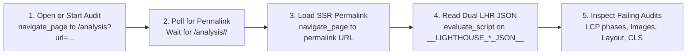

# Run `pagespeed.web.dev` audits

Static HTTP tools (`curl`, `fetch`) fail on [PageSpeed Insights](https://pagespeed.web.dev/) while an audit runs. Full DOM snapshots (`take_snapshot`) also flood your token budget with thousands of UI nodes and hide byte-level data.

Instead, **PageSpeed Insights writes the full Lighthouse Result (LHR) JSON trees for both Mobile and Desktop onto `window`**:
- `window.__LIGHTHOUSE_MOBILE_JSON__`
- `window.__LIGHTHOUSE_DESKTOP_JSON__`

Drive a browser tab with `chrome-devtools-mcp` and read these two `window` objects via `evaluate_script` to get both Mobile and Desktop reports in one call. You get exact byte savings, four-phase LCP timings, network request chains, and source-mapped stack traces without clicking UI tabs or scraping DOM text.

---

## Core concepts and rules

### 1. Dual report extraction from `window`
- **Rule**: Read `window.__LIGHTHOUSE_MOBILE_JSON__` and `window.__LIGHTHOUSE_DESKTOP_JSON__` via `evaluate_script`. Do not take DOM snapshots or switch Mobile and Desktop tabs in the UI.
- **Why it holds**: Server-side rendering (SSR) on `pagespeed.web.dev` writes both Mobile and Desktop Lighthouse runs into global JavaScript variables on page load, even though the DOM shows only one tab at a time.
- **What it forbids**: Never call `take_snapshot` to read PageSpeed Insights scores or audit tables. Never waste round-trips clicking the Desktop or Mobile tab buttons to inspect the second form factor.
- **Scope limit**: Applies to `pagespeed.web.dev` report permalinks; local Lighthouse runs use the `lighthouse_audit` tool directly.

### 2. Server-rendered permalink reload gate
- **Rule**: After starting a new audit on `/analysis?url=...`, wait for the URL to change to `/analysis/<domain-slug>/<report-id>`. Then run `navigate_page` on that permalink before reading `window.__LIGHTHOUSE_*_JSON__`.
- **Why it holds**: When an in-browser audit finishes, the single-page app (SPA) updates the address bar via `history.pushState` and renders from local state. The server only injects `window.__LIGHTHOUSE_MOBILE_JSON__` and `window.__LIGHTHOUSE_DESKTOP_JSON__` during a full SSR page load of the permalink URL.
- **What it forbids**: Never read `window.__LIGHTHOUSE_*_JSON__` right after `window.location.href` changes in-place without reloading the permalink first.

### 3. Four-phase paint timing split
- **Rule**: Split every LCP (`Largest Contentful Paint`) bottleneck into its four phases (`timeToFirstByte`, `resourceLoadDelay`, `resourceLoadDuration`, `elementRenderDelay`) from `lcp-breakdown-insight` before changing code.
- **Why it holds**: The four phases are separate and add up to 100% of LCP time. Compressing an image only shrinks `resourceLoadDuration`. It does nothing when late lookup (`resourceLoadDelay`) or main-thread blocking (`elementRenderDelay`) drives LCP.
- **What it forbids**: Never compress images or tune CDN caching to fix LCP until you confirm that `resourceLoadDuration` or `timeToFirstByte` is the largest phase.

### 4. Rendered box image parity
- **Rule**: Size and crop page images to match their painted CSS box times `window.devicePixelRatio`. Set `sizes` to match real layout slot widths across breakpoints.
- **Why it holds**: `image-delivery-insight` computes `wastedBytes` by comparing file dimensions (`naturalWidth * naturalHeight`) against the painted CSS box (`boundingRect.width * boundingRect.height * dpr^2`). Serving uncropped aspect ratios inside `object-fit: cover` boxes or leaving `sizes="100vw"` on grids forces browsers to download pixels that they clip or scale down.
- **What it forbids**: Never rely on CSS `object-fit: cover` to crop large source images at runtime. Never use `loading="lazy"` or `decoding="async"` on the hero LCP image.

### 5. Critical-path network and thread guards
- **Rule**: Keep the pre-LCP network and main-thread window free of blocking stylesheets, sync scripts, extra `fetch`/`XHR` calls, and DOM read-after-write layout thrashing.
- **Why it holds**: Early background requests compete with critical assets for sockets and bandwidth. Custom request headers (like `Content-Type: application/json` on simple requests) also trigger extra CORS preflight `OPTIONS` round-trips. Sync scripts and forced layout passes block the main thread from painting the LCP node even after its bytes arrive (`elementRenderDelay`).
- **What it forbids**: Never fire non-essential tracking or extra hydration requests before `window.load` and `requestAnimationFrame`. Never read layout properties (`offsetWidth`, `getBoundingClientRect`) right after DOM writes during initial load.

---

## End-to-end workflow



### Step 1: Open a report or start a fresh audit

Load the `chrome-devtools-mcp` tools (`navigate_page`, `evaluate_script`, `new_page`, `list_pages`).

- **If the user shared a report permalink** (`https://pagespeed.web.dev/analysis/<domain-slug>/<report-id>`):
  Open that URL with `navigate_page` and skip to **Step 3**.
- **To start a new live audit**:
  Open the query endpoint (which starts the audit right away):
  ```text
  https://pagespeed.web.dev/analysis?url=https%3A%2F%2Fexample.com%2F
  ```
  Or click the `"Analyze"` button on an open PageSpeed Insights page via `evaluate_script`:
  ```javascript
  () => {
    const btn = Array.from(document.querySelectorAll('button'))
      .find((b) => b.textContent.trim() === 'Analyze');
    if (btn) {
      btn.click();
      return { clicked: true, url: window.location.href };
    }
    return { clicked: false, url: window.location.href };
  }
  ```

### Step 2: Wait for the permalink and reload from the server

While Google's lab runners run Lighthouse (~15–30 seconds), the URL stays at `/analysis?url=...`. Once both Mobile and Desktop runs finish, the SPA rewrites `window.location.href` to `/analysis/<domain-slug>/<report-id>`.

Once `window.location.pathname` matches `/^\/analysis\/[^/]+\/[^/]+/`, call `navigate_page` on that exact `window.location.href` so the server returns SSR HTML with `window.__LIGHTHOUSE_MOBILE_JSON__` and `window.__LIGHTHOUSE_DESKTOP_JSON__`.

### Step 3: Extract the mobile and desktop scorecard

Run this `evaluate_script` function on the permalink to read Mobile and Desktop scores, Core Web Vitals (`FCP`, `LCP`, `TBT`, `CLS`, `SI`), and every failing audit in one call:

```javascript
() => {
  const m = window.__LIGHTHOUSE_MOBILE_JSON__?.lighthouseResult || window.__LIGHTHOUSE_MOBILE_JSON__;
  const d = window.__LIGHTHOUSE_DESKTOP_JSON__?.lighthouseResult || window.__LIGHTHOUSE_DESKTOP_JSON__;

  const extractSummary = (lhr) => {
    if (!lhr || !lhr.categories) return null;
    const scores = Object.fromEntries(
      Object.entries(lhr.categories).map(([k, v]) => [k, Math.round(v.score * 100)])
    );
    const metrics = {
      FCP: lhr.audits['first-contentful-paint']?.displayValue,
      LCP: lhr.audits['largest-contentful-paint']?.displayValue,
      TBT: lhr.audits['total-blocking-time']?.displayValue,
      CLS: lhr.audits['cumulative-layout-shift']?.displayValue,
      SI:  lhr.audits['speed-index']?.displayValue,
    };
    const failingAudits = Object.entries(lhr.audits)
      .filter(([, a]) => a.score !== null && a.score < 1 && a.scoreDisplayMode !== 'informative')
      .map(([id, a]) => ({
        id,
        title: a.title,
        score: a.score,
        displayValue: a.displayValue,
      }));
    return { fetchTime: lhr.fetchTime, scores, metrics, failingAudits };
  };

  return {
    url: window.location.href,
    mobile: extractSummary(m),
    desktop: extractSummary(d),
  };
}
```

### Step 4: Inspect failing audits

Query the failing audit keys inside `window.__LIGHTHOUSE_MOBILE_JSON__` or `window.__LIGHTHOUSE_DESKTOP_JSON__` to get exact DOM selectors, URLs, byte counts, and stack traces:

```javascript
() => {
  const lhr = window.__LIGHTHOUSE_MOBILE_JSON__?.lighthouseResult || window.__LIGHTHOUSE_MOBILE_JSON__;
  const pick = (id) => {
    const a = lhr?.audits?.[id];
    if (!a) return null;
    return {
      score: a.score,
      displayValue: a.displayValue,
      description: a.description,
      details: a.details,
    };
  };

  return {
    // 1. LCP Element & 4-Phase Timing Breakdown (TTFB, Load Delay, Load Duration, Render Delay)
    lcpBreakdown: pick('lcp-breakdown-insight'),
    lcpDiscovery: pick('lcp-discovery-insight'),
    rawTimings: lhr?.audits?.['metrics']?.details?.items?.[0],

    // 2. Render-Blocking Requests & Critical Network Dependency Chain
    renderBlocking: pick('render-blocking-insight'),
    networkTree: pick('network-dependency-tree-insight'),

    // 3. Image Delivery (wastedBytes, rendered boundingRect vs natural dimensions)
    imageDelivery: pick('image-delivery-insight'),

    // 4. Main-Thread Bottlenecks (Unused JS, Long Tasks, Forced Reflows with source locations)
    unusedJs: pick('unused-javascript'),
    longTasks: pick('long-tasks'),
    forcedReflow: pick('forced-reflow-insight'),

    // 5. Layout Shifts, Accessibility, and Browser Inspector Issues
    clsCulprits: pick('cls-culprits-insight'),
    colorContrast: pick('color-contrast'),
    inspectorIssues: pick('inspector-issues'),
  };
}
```

---

## Audit reference table

| Audit ID | Signal | Fix pattern |
| :--- | :--- | :--- |
| `lcp-breakdown-insight` | Splits LCP into `timeToFirstByte`, `resourceLoadDelay`, `resourceLoadDuration`, and `elementRenderDelay`, and finds the LCP DOM node. | **High `resourceLoadDelay`**: Fetch the LCP asset early with `<link rel="preload" as="image" imagesrcset="..." imagesizes="..." fetchpriority="high">` in `<head>`. **High `elementRenderDelay`**: Inline critical CSS, remove `decoding="async"` on the LCP ``, and defer third-party scripts until user input. |
| `image-delivery-insight` | Lists each failing `` with `totalBytes`, `wastedBytes`, `boundingRect` (painted CSS pixels), and `subItems` (`compression` vs. `file size`). | Encode in modern formats (AVIF or WebP), crop assets to match the box aspect ratio, align `sizes` with CSS layout widths across breakpoints, and tune quality. |
| `render-blocking-insight` | Lists `<link rel="stylesheet">` or sync `<script>` tags in `<head>` that block `FCP` and `LCP`. | Inline critical first-screen CSS into `<style>`, load non-critical stylesheets in the background, and add `defer` or `type="module"` to scripts. |
| `network-dependency-tree-insight` | Shows critical request chains and missing `preconnect` hints triggered before LCP finishes. | Defer non-essential `fetch`/`XHR` calls until after `window.load` and `requestAnimationFrame`. Avoid custom headers that trigger CORS preflight `OPTIONS` requests on simple endpoints. |
| `forced-reflow-insight` | Reports the exact JS function, script URL, line, and column reading layout properties (`offsetWidth`, `getBoundingClientRect`) after DOM writes. | Batch all DOM geometry reads before DOM writes inside `requestAnimationFrame`, or defer third-party scripts until user input. |
| `inspector-issues` | Lists browser DevTools warnings such as lazy-loaded images on the initial screen or missing image dimensions. | Never set `loading="lazy"` on first-screen images; always set explicit `width` and `height` values on every ``. |

---

## Local pre-release checks

Before deploying to production to re-test on `pagespeed.web.dev`, check your fixes against your local server (`http://localhost:<port>/`) with `chrome-devtools-mcp`:

1. Run `lighthouse_audit` (`mode: "navigation"`, `device: "mobile"` and `"desktop"`) on the local tab to confirm group scores and catch regressions.
2. Run `evaluate_script` to check that every visible `` has `naturalWidth` close to `clientWidth * window.devicePixelRatio`, uses `fetchpriority="high"` without `loading="lazy"` on the LCP node, and leaves zero blocking scripts in `<head>`.
