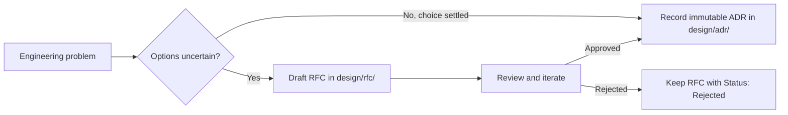

# Design documents: RFCs and ADRs

Use this skill to draft shared design proposals (RFCs) and keep lasting choice logs (ADRs). Splitting open exploration from final records keeps active debates focused and stops teams from reopening settled constraints later.

## Choosing between an RFC and an ADR

| Doc type | Folder | Mutability | Goal | When to write |
| :--- | :--- | :--- | :--- | :--- |
| **RFC** | `design/rfc/` | Fluid in review | Weigh options and align | New features or unclear design paths |
| **ADR** | `design/adr/` | Locked once approved | Log one choice and its impact | Approved RFCs or direct design choices |



Write an RFC when ambiguity is high and several paths exist. Skip the RFC and log an ADR directly when the problem and trade-offs are already clear.

## Directory layout and naming

Store both document types under `design/` as Markdown (`.md`) files with four-digit sequential numbers starting at `0001`:

```text
design/
  rfc/
    0001-use-structured-logging.md
    0002-migrate-to-sqlite-cache.md
  adr/
    0001-record-architecture-decisions.md
    0002-use-stdio-mcp-transport.md
```

- Name RFC files after the topic with a short slug (`NNNN-short-descriptive-title.md`).
- Name ADR files after the choice made with an active verb slug (`NNNN-use-sqlite-cache.md`).

## Request for Comments: RFC workflow

An RFC moves through five lifecycle states:

- **Draft**: Initial exploration is in progress and open for early edits.
- **Ready for Review**: Proposal is complete and awaiting team feedback.
- **In Review**: Reviewers are actively debating options and open questions.
- **Approved**: Reviewers sign off; link one or more follow-up ADR files in the header.
- **Rejected**: Proposal proved non-viable; keep the file in `design/rfc/` with reasons logged so teams do not repeat the same debate.

Use this template when drafting an RFC:

```markdown
# RFC-NNNN: [Descriptive Proposal Title]

- Status: [Draft | Ready for Review | In Review | Approved | Rejected]
- Date: [YYYY-MM-DD]
- Authors: [Names]
- Reviewers: [Names]
- ADR Reference: [Link to ADR-XXXX if approved, or None]

## Summary

Two to three sentences stating the problem, recommended direction, and expected outcome.

## Problem and Constraints

Describe the current system behavior, pain points, performance bottlenecks, and operational constraints objectively.

## Proposed Design

Detail the architecture, API contracts, data model changes, or rollout plan. Include diagrams or short interfaces to clarify boundaries.

## Discarded Alternatives

List every alternative seriously evaluated and the concrete limitations that ruled it out.

## Spikes and Evidence

Summarize benchmarks, prototype findings, and throwaway probes placed outside tracked production directories.

## Open Questions

List unresolved decisions or edge cases where reviewer input is needed before approval.

## References

Link primary documentation, related RFCs or ADRs, and relevant source files.
```

## Architecture Decision Records: ADR workflow

> [!IMPORTANT]
> - **Keep ADRs brief**: Limit each record to one or two pages covering the choice and its core forces rather than full specs.
> - **Treat approved ADRs as locked logs**: Never edit a committed decision later. When direction changes, write a new ADR and update only the status line of the old file to `Superseded by ADR-NNNN`.
> - **Name downsides plainly**: List new tech debt, runtime costs, and limits added by the choice.

Use this template when logging an ADR:

```markdown
# ADR-NNNN: [Active Verb Title]

- Status: [Proposed | Approved | Superseded by ADR-XXXX | Rejected]
- Date: [YYYY-MM-DD]
- Authors: [Names]
- Deciders: [Names]
- RFC Reference: [Link to RFC-XXXX, or None]

## Background and Forces

State the factual background, technical constraints, and organizational forces at play.

## Decision

State the chosen architectural path clearly, explain why it wins under current constraints, and note rejected options.

## Consequences

List positive outcomes, negative trade-offs or maintenance burdens, and new architectural invariants.

## Verification

Specify the automated tests, linters, schema checks, or pipeline gates that verify this decision stays intact.
```

## Quality checklist

- Does the record state competing technical and runtime forces plainly?
- Does it list rejected paths with concrete reasons rather than vague dismissal?
- Does it state measurable trade-offs instead of empty praise like `clean`, `elegant`, or `flawless`?
- Does `Verification` name concrete tests, build gates, or runtime invariants?
- Do both headers cross-link status and file paths when reviewers approve an RFC?
