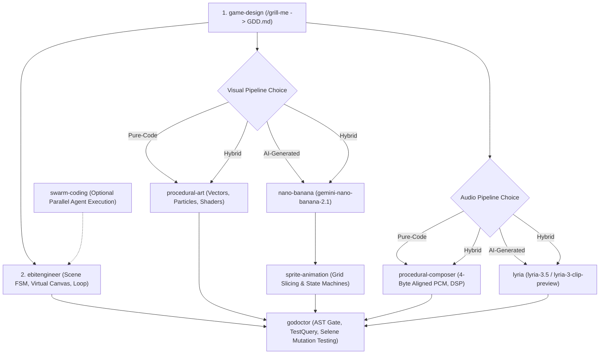

# Vibe Game Developer: Master Orchestrator & Request Router

This master skill teaches the agent how to analyze, classify, and route 2D game development requests to the specialized skills in the Game Dev Starter Kit—and how to compose them as modular, independent building blocks.

> [!NOTE]
> **100% Genre-Agnostic & Modular Design Principle**:
> Every skill in this suite is an **independent, composable building block suitable for any 2D game genre**—including **top-down RPGs, bullet-heavens, twin-stick/vertical shmups, turn-based tactics, roguelike deckbuilders, grid/physics puzzles, visual novels, rhythm games, and side-scrolling platformers**. Never assume side-scrolling physics or a single fixed asset pipeline: activate only the skills required for the user's task, and combine pure-code procedural skills (`procedural-art`, `procedural-composer`) with AI-generated media skills (`nano-banana`, `lyria`) freely in pure or hybrid pipelines.

---

## 1. Modular Skill Ecosystem & Intent Routing Matrix

Each skill in the starter kit has a distinct, orthogonal responsibility and can be invoked standalone or composed into a multi-skill workflow:

| User Intent / Request Type | Specialized Skill | Modular Role & Key Technical Characteristics |
| :--- | :--- | :--- |
| **Game Design & Socratic Interview** | **[`game-design`](../game-design/SKILL.md)** | **Game Designer**: Interactive `/grill-me` Socratic interview across all 2D genres, explicit choice between procedural (`procedural-art`/`procedural-composer`), AI (`nano-banana`/`lyria`), or hybrid asset pipelines, and authoritative `GDD.md` authoring. |
| **Ebitengine 2D Engine Architecture** | **[`ebitengineer`](../ebitengineer/SKILL.md)** | **Engine Architect**: Genre-agnostic Ebitengine (v2) loop, virtual resolution scaling, FSM/stack scene management (pause/inventory/deck/dialogue overlays), fixed-timestep $\Delta t$, zero-allocation `Draw()` loop, Kage shaders, and WebAssembly audio/browser deployment. |
| **Pure-Code DSP Audio Synthesis** | **[`procedural-composer`](../procedural-composer/SKILL.md)** | **DSP Sound Engineer**: Zero-asset 16-bit 44.1 kHz stereo PCM audio synthesis (`sound.go`), mandatory 4-byte frame alignment (`&^ 3`), YM2612 6-channel polyphony, FM synthesis, ADSR envelopes, DSP post-processing (`SliceLoopPCM`, LPF/HPF, bitcrushing), and WAV export (`play.go`). |
| **Generative Studio AI Music** | **[`lyria`](../lyria/SKILL.md)** | **AI Music Composer**: High-fidelity 44.1 kHz stereo soundtracks and loops via **Lyria 3.5** (`lyria-3.5` / `lyria-3-pro-preview`) and **Lyria 3 Clip** (`lyria-3-clip` / `lyria-3-clip-preview`), timestamped arrangements, custom lyrics, multimodal image-to-music, and `.mp3`/`.wav` export. |
| **Pure-Code Procedural 2D Graphics** | **[`procedural-art`](../procedural-art/SKILL.md)** | **Procedural Technical Artist**: Zero-asset Go texture generation (`art.go`), 2D `GeoM` matrix transform ordering, 32-bit RGBA color ramps, sub-frame animation easing, pre-allocated particle pools, and Kage shaders. |
| **Generative AI Images & Sprites** | **[`nano-banana`](../nano-banana/SKILL.md)** | **AI Visual Artist**: Conversational image generation and editing via **Nano Banana 2.1** (`gemini-nano-banana-2.1`), `gemini-3.1-flash-lite-image`, and `gemini-3-pro-image` for sprite sheets, character portraits, card art, tilesets, and multi-image style/character consistency. |
| **2D Sprite Slicing & Animation** | **[`sprite-animation`](../sprite-animation/SKILL.md)** | **2D Animator**: Sprite sheet grid slicing (`SubImage` zero-alloc views), animation state machines (`idle`, `walk`, `attack`, `cast`, `hit`, `death`), frame timing, Aseprite (`.ase`/`.aseprite`) integration, and Ebitengine animation controllers. |
| **Go Code Quality & Mutation Testing** | **[`godoctor`](../godoctor/SKILL.md)** | **Go Quality Gate**: AST integrity validation, compiler rollback gates (`smart_build`, `smart_edit`), TestQuery SQLite test/coverage analytics, and Selene mutation testing. |
| **Multi-Agent Swarm Coordination** | **[`swarm-coding`](../swarm-coding/SKILL.md)** | **Swarm Coordinator**: Hierarchical divide-and-conquer multi-agent orchestration across disjoint packages (e.g., concurrent engine core, procedural/AI assets, UI/HUD, and QA). |

---

## 2. How the 9 Building Blocks Compose Together

---

## 3. Decision Rules: Pure-Code Procedural vs. Generative AI vs. Hybrid Assets

A core responsibility of this orchestrator is honoring the `GDD.md` pipeline selection (or guiding the user when asked ad-hoc) between **pure-code procedural generation**, **2026 Gemini/Lyria AI models**, or a **hybrid pipeline**:

### 3.1 Audio & Music Routing Rules (`procedural-composer` vs. `lyria`)

* **Choose [`procedural-composer`](../procedural-composer/SKILL.md)** when:
  - Synthesizing **Game Sound Effects (SFX)**: UI clicks, card draws, sword slashes, laser blasts, explosions, or status chimes.
  - Composing 6-channel YM2612-style chiptune BGM in pure Go with zero external audio files.
  - Applying runtime DSP post-processing (`SliceLoopPCM`, ADSR envelopes, low-pass/high-pass filtering, bitcrushing) or enforcing 4-byte stereo PCM alignment (`&^ 3`) for Ebitengine `audio.Context`.

* **Choose [`lyria`](../lyria/SKILL.md)** when:
  - Generating studio-quality **44.1 kHz stereo Background Music (BGM)** via **Lyria 3.5** (`lyria-3.5` / `lyria-3-pro-preview`) for full multi-section arrangements or **Lyria 3 Clip** (`lyria-3-clip` / `lyria-3-clip-preview`) for 30-second loops.
  - Composing thematic soundtracks directly from concept art or screenshots (multimodal image-to-music).

* **Choose a Hybrid Audio Pipeline** when:
  - Combining `lyria` (`lyria-3.5` / `lyria-3-clip-preview`) for rich `.mp3`/`.wav` BGM beds with `procedural-composer` for instant, zero-latency procedural gameplay SFX and DSP loop slicing.

---

### 3.2 Graphics & Visual Routing Rules (`procedural-art` vs. `nano-banana` + `sprite-animation`)

* **Choose [`procedural-art`](../procedural-art/SKILL.md)** when:
  - Generating pure-code textures (`art.go`), crisp geometric entities, tactical grids, particle pools, or Kage post-processing shaders with zero external `.png` files.
  - Implementing 2D `GeoM` matrix hierarchy transforms or sub-frame interpolation curves.

* **Choose [`nano-banana`](../nano-banana/SKILL.md) + [`sprite-animation`](../sprite-animation/SKILL.md)** when:
  - Generating character sprite sheets, visual novel portraits, deckbuilder card illustrations, or seamless tilesets using **Nano Banana 2.1** (`gemini-nano-banana-2.1`), `gemini-3.1-flash-lite-image` (high-speed prototyping), or `gemini-3-pro-image` (complex multi-subject composition).
  - Slicing generated sprite sheets into zero-allocation `SubImage` frames and driving state machines (`idle`, `walk`, `attack`, `cast`, `death`) via `sprite-animation`.

* **Choose a Hybrid Visual Pipeline** when:
  - Using `nano-banana` (`gemini-nano-banana-2.1`) + `sprite-animation` for hero/enemy sprites, portraits, or card art while using `procedural-art` for UI panels, particle bursts, projectiles, and Kage screen shaders.

---

## 4. End-to-End Game Development Lifecycle

When guiding the user through building a complete 2D game from scratch (or executing any phase independently):

1. **Concept & GDD (`/grill-me`)**: Activate [`game-design`](../game-design/SKILL.md) to run a genre-agnostic Socratic interview, lock in the mechanics, controls, and visual/audio pipeline choice (Procedural, AI, or Hybrid), and write `GDD.md`.
2. **Engine Architecture**: Activate [`ebitengineer`](../ebitengineer/SKILL.md) to scaffold `internal/` packages, virtual resolution scaling, scene state machine (or overlay stack for RPGs/deckbuilders/tactics), fixed-timestep $\Delta t$, and spatial collision/grid systems.
3. **Visual Pipeline Execution**:
   - **Procedural**: Activate [`procedural-art`](../procedural-art/SKILL.md) for in-memory sprites, vector geometry, particle pools, and Kage shaders.
   - **AI / Hybrid**: Activate [`nano-banana`](../nano-banana/SKILL.md) (`gemini-nano-banana-2.1`, `gemini-3.1-flash-lite-image`, `gemini-3-pro-image`) to generate sprite sheets/art and [`sprite-animation`](../sprite-animation/SKILL.md) to slice frames and wire animation controllers.
4. **Audio Pipeline Execution**:
   - **Procedural**: Activate [`procedural-composer`](../procedural-composer/SKILL.md) for 4-byte aligned (`&^ 3`) 16-bit stereo SFX, DSP filters, and 6-channel BGM.
   - **AI / Hybrid**: Activate [`lyria`](../lyria/SKILL.md) (`lyria-3.5` / `lyria-3-pro-preview`, `lyria-3-clip-preview`) for 44.1 kHz stereo soundtracks and combine with [`procedural-composer`](../procedural-composer/SKILL.md) for loop slicing and SFX.
5. **Parallel Execution (Optional)**: For multi-system builds with orthogonal workstreams, activate [`swarm-coding`](../swarm-coding/SKILL.md) to coordinate parallel specialist subagents across disjoint file sets.
6. **Quality Gate & Verification**: Activate [`godoctor`](../godoctor/SKILL.md) to validate AST integrity, run unit tests with TestQuery analytics, and eliminate test blind spots via Selene mutation testing.
7. **WebAssembly & Cloud Run Deployment**: Activate [`ebitengineer`](../ebitengineer/SKILL.md) to compile to WASM with browser audio unlock synchronization and package for deployment.
