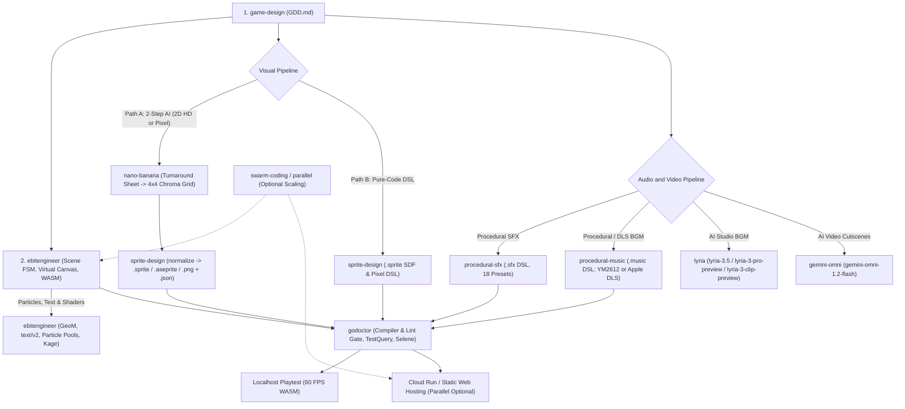

# Vibe game developer: 2D Go game workflow router

`vibe-game-developer` is the primary router for building 2D games in Go with Ebitengine (`github.com/hajimehoshi/ebiten/v2`). Use it to classify requests, choose between pure-code procedural and generative AI asset pipelines, and compose specialized skills as modular building blocks.

> [!NOTE]
> **Genre-agnostic and modular design**:
> Every skill in this suite works as an independent building block for any 2D genre, including top-down RPGs, bullet-heavens, twin-stick or vertical shmups, `2:1` isometric tactics, roguelike deckbuilders, grid or physics puzzles, visual novels, rhythm games, and side-scrolling platformers. Never assume side-scrolling gravity or a single fixed asset pipeline. Activate only the skills needed for the current task, and mix procedural DSL skills (`sprite-design`, `procedural-sfx`, `procedural-music`) with generative media skills (`nano-banana`, `lyria`, `gemini-omni`) in pure or hybrid builds.

## Skill ecosystem and intent routing matrix

Each skill owns a distinct domain and works either standalone or as part of a full build:

| User Intent / Task | Target Skill | Role & Core Capabilities |
| :--- | :--- | :--- |
| **Game design and GDD creation** | `game-design` | **Game Designer**: Runs a focused one-decision-at-a-time interview across any 2D genre, locks in visual and audio pipeline choices, and writes `GDD.md`. |
| **Ebitengine architecture and WASM** | `ebitengineer` | **Engine Architect**: Scaffolds `internal/` packages, virtual resolution scaling, scene state machines, fixed-timestep updates, zero-allocation `Draw()` loops, Kage shaders, and `GOOS=js GOARCH=wasm` builds. |
| **Sprites, tilesets, and animation** | `sprite-design` | **2D Technical Artist**: Normalizes raw AI grids into `.sprite`, `.png`, `.json`, and `.aseprite` at `32x32` pixel art up to `256x256+` 2D HD, or compiles `.sprite` SDF/pixel DSL files with zero-allocation `AnimationController`. |
| **Generative art and turnaround sheets** | `nano-banana` | **AI Visual Artist**: Generates character sheets, raw `4x4` animation grids on `#00FF00` or `#FF00FF` chroma-key backgrounds, `4:1` parallax layers, portraits, and cards via `gemini-nano-banana-2.1`, `gemini-3.1-flash-lite-image`, `gemini-3.1-flash-image`, and `gemini-3-pro-image` using `scripts/banana.py`. |
| **Procedural SFX (`.sfx`)** | `procedural-sfx` | **SFX Designer**: Synthesizes 4-byte aligned (`&^ 3`) 16-bit 44.1 kHz stereo PCM cues in memory from `.sfx` DSL with PolyBLEP anti-aliasing, 18 built-in presets, SVF filter sweeps, 16-bit Galois LFSR noise, and validation. |
| **Procedural chiptune and DLS BGM (`.music`)** | `procedural-music` | **Procedural Composer**: Compiles polyphonic `.music` scores (8 to 12+ channels, verified `|` barlines, `~` cross-bar ties) into 4-byte aligned stereo PCM using pure-Go SEGA Mega Drive YM2612 + SN76489 or macOS CoreAudio (`-apple` / `gs_instruments.dls`). |
| **Generative studio AI music** | `lyria` | **AI Music Composer**: Generates 44.1 kHz stereo soundtracks and loops via `lyria-3.5`, `lyria-3-pro-preview`, and `lyria-3-clip-preview` using `scripts/lyria.py` (`--enterprise` ADC or `GEMINI_API_KEY`), including custom lyrics and image-to-music. |
| **AI video cutscenes and editing** | `gemini-omni` | **AI Video Director**: Generates, edits, interpolates, extends, and upscales `3s` to `15s` animated cutscenes (`360p` to `4k` at `24 FPS`) with synchronized audio via `gemini-omni-1.2-flash` using `scripts/omni.py`. |
| **Go verification and mutation testing** | `godoctor` | **Go Quality Gate**: Runs compiler gates, linters, TestQuery (`tq`) SQL analytics, and Selene mutation testing via `godoctor call` CLI (`edit`, `build`, `test`, `docs`, `selene`, `tq`) or MCP tools (`smart_edit`, `smart_build`, `smart_test`, `read_docs`, `selene`, `test_query`). |
| **Parallel multi-agent scaling** | `swarm-coding`, `parallel` | **Multi-Agent Coordinators**: Split large engine builds or asset batches across concurrent workers on disjoint packages or files. |

## Architecture and workflow composition



## Asset pipeline decision rules

Follow the pipeline choice recorded in `GDD.md`, or help the user select the right mix before creating assets.

### Sprites, visuals, and engine VFX

Align on animation motion tags, camera projection (`2D side-profile`, `3/4 top-down`, `2:1 isometric`, or `front-facing ortho`), resolution (`256x256+` Native 2D HD vs. `32x32`/`64x64` pixel art), and production path first:

- **Path A: Two-step AI character sheet to sprite grid (`nano-banana` + `sprite-design` `normalize`)**:
  - Best for expressive heroes, bosses, NPCs, creatures, and isometric units with 4 or more motion tags (`idle`, `walk`, `run`, `jump`, `fall`, `crouch`, `sleep`, `attack`, `hit`, `death`).
  - **Step 1**: Use `nano-banana` (`uv run scripts/banana.py` with `gemini-nano-banana-2.1`) to create a turnaround sheet with `1:2` to `1:3` proportions, matching camera projection, clear limb separation, and a 4-step color swatch bar.
  - **Step 2**: Pass that reference sheet via `-i` to `nano-banana` (`uv run scripts/banana.py`) to generate uniform `4x4` animation grids on `#00FF00` or `#FF00FF` chroma-key backgrounds with 10% to 15% cell margins. Run `sprite-design` (`go run . normalize`) to strip chroma backgrounds, trim bleed, align frames, export `.sprite`, `.png`, `.json`, `.aseprite`, and looping `.gif` previews, and wire `NewGridSpriteSheet` and `AnimationController`.
  - **Fail fast on auth errors**: Media CLIs (`scripts/banana.py`, `scripts/lyria.py`, `scripts/omni.py`) support Vertex AI / Gemini Enterprise ADC (`GOOGLE_CLOUD_LOCATION="global"`) and `GEMINI_API_KEY`. If authentication fails, stop immediately and report the exact error instead of fabricating mock images or switching pipelines silently.
- **Path B: Pure-code procedural `.sprite` DSL (`sprite-design`)**:
  - Best for zero-asset builds, geometric enemies, vehicles, puzzle tokens, projectiles, pickups, props, and seamless tilesets.
  - Author declarative `.sprite` files using Z-ordered `part` blocks, SDF and pixel primitives, 12 Retro-HD palettes, 12 four-step material ramps, and keyframed `tag`/`pose` animations. Validate with `go run . validate` and compile in memory (`CompileSpriteDSL`) or export to `.aseprite` and `.png` + `.json`.
- **Backgrounds, portraits, and runtime VFX (`nano-banana` + `ebitengineer`)**:
  - Use `nano-banana` for title art, seamless `4:1` parallax layers, visual novel portraits, and deckbuilder card illustrations.
  - Use `ebitengineer` for pre-allocated particle pools, `text/v2` HUD typography, 2D `GeoM` transforms, procedural textures, and Kage screen shaders.

### Audio, music, and video cutscenes

All PCM buffers passed to Ebitengine's `audio.Context` or `audio.NewInfiniteLoop` must enforce 4-byte stereo sample frame alignment (`len(pcm) &^ 3`).

- **Choose `procedural-sfx`** for low-latency gameplay SFX cues in `.sfx` DSL (lasers, slashes, explosions, jumps, coins, UI ticks, engine loops) using 18 built-in presets, duty-cycle or SVF sweeps, 16-bit Galois LFSR noise (`wave=psg_noise`), and `ValidateProductionSFX`.
- **Choose `procedural-music`** for original multi-channel `.music` BGM scores (`8` to `12+` tracks, `30s` to `150s+` duration, verified `|` barlines, `~` cross-bar ties, sample-exact looping) synthesized via pure-Go SEGA YM2612 + SN76489 (`synth default`) or macOS CoreAudio (`synth apple` / `-apple` backed by `gs_instruments.dls`).
- **Choose `lyria`** for studio AI music tracks or vocal songs via `lyria-3.5`, `lyria-3-pro-preview`, or `lyria-3-clip-preview` (`uv run scripts/lyria.py`), including image-to-music soundtracks from concept art or screenshots.
- **Choose `gemini-omni`** for animated `3s` to `15s` intro/outro cutscenes, animated title loops, first-and-last-frame transitions, or `4k` promotional videos with synchronized audio via `gemini-omni-1.2-flash` (`uv run scripts/omni.py`).
- **Choose a hybrid audio and cutscene pipeline** when combining `procedural-sfx` for zero-latency cooldown-gated SFX with `procedural-music` for looping stage themes, `lyria` for orchestral or vocal boss/menu tracks, and `gemini-omni` for video cutscenes.

## End-to-end lifecycle, WebAssembly build, and deployment

Run phases sequentially from scratch or enter at any stage:

1. **Game design (`game-design`)**: Run focused discovery to lock mechanics, virtual resolution, controls, and pipeline choices into `GDD.md`.
2. **Engine scaffolding (`ebitengineer`)**: Scaffold `internal/` packages, virtual resolution scaling, scene FSM or overlay stack, fixed-timestep loop, and zero-allocation rendering.
3. **Visual assets (`nano-banana` + `sprite-design`)**: Confirm motion tags, projection, and resolution, then execute Path A (`nano-banana` -> `normalize`) or Path B (`.sprite` DSL) and verify looping `.gif` previews.
4. **Audio and cutscenes (`procedural-sfx`, `procedural-music`, `lyria`, `gemini-omni`)**: Synthesize `.sfx` cues, `.music` scores or `lyria` tracks, and optional `gemini-omni` cutscenes.
5. **Parallel scaling (optional: `swarm-coding`, `parallel`)**: Fan out independent packages or asset batches across workers with disjoint file ownership.
6. **Verification and deployment (`godoctor` + `ebitengineer`)**: Run `godoctor` build, lint, coverage, and mutation checks, compile `GOOS=js GOARCH=wasm`, test locally on `http://localhost:8080`, and optionally deploy containers to Cloud Run in parallel.

### Compile to WebAssembly and serve locally

Build `public/game.wasm`, copy Go's `wasm_exec.js` shim from `GOROOT`, and serve locally (see `ebitengineer` `references/server_architecture.md` for complete `cmd/server/main.go` and `index.html` templates):

```bash
mkdir -p public
GOOS=js GOARCH=wasm go build -o public/game.wasm ./cmd/game

GOROOT_DIR="$(go env GOROOT)"
if [ -f "$GOROOT_DIR/lib/wasm/wasm_exec.js" ]; then
  cp "$GOROOT_DIR/lib/wasm/wasm_exec.js" public/wasm_exec.js
else
  cp "$GOROOT_DIR/misc/wasm/wasm_exec.js" public/wasm_exec.js
fi

PORT=8080 go run ./cmd/server
```

### Containerize and deploy to Google Cloud Run

Use a multi-stage `Dockerfile` that compiles `public/game.wasm`, embeds static assets, and serves via a minimal Go HTTP server:

```dockerfile
FROM golang:1.27-alpine AS builder
WORKDIR /app
COPY go.mod go.sum ./
RUN go mod download
COPY . .

RUN mkdir -p public && \
    GOOS=js GOARCH=wasm go build -o public/game.wasm ./cmd/game && \
    if [ -f "$(go env GOROOT)/lib/wasm/wasm_exec.js" ]; then \
      cp "$(go env GOROOT)/lib/wasm/wasm_exec.js" public/wasm_exec.js; \
    else \
      cp "$(go env GOROOT)/misc/wasm/wasm_exec.js" public/wasm_exec.js; \
    fi && \
    cp index.html public/

RUN CGO_ENABLED=0 GOOS=linux go build -o /server ./cmd/server

FROM gcr.io/distroless/static-debian12
COPY --from=builder /server /server
EXPOSE 8080
ENTRYPOINT ["/server"]
```

Build from source and deploy directly with Cloud Run + Artifact Registry:

```bash
SERVICE_NAME="ebiten-wasm-game"
REGION="us-central1"

gcloud run deploy "${SERVICE_NAME}" \
  --source . \
  --region "${REGION}" \
  --allow-unauthenticated
```
