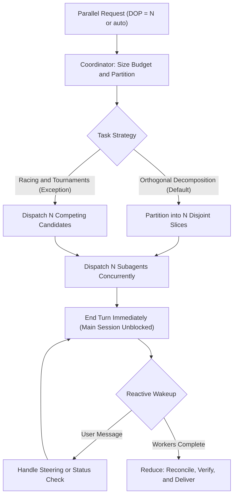

# Parallel: task concurrency and agent scaling engine

`parallel` is a domain-agnostic task parallelization and subagent scaling engine. It partitions complex work across concurrent subagents using an explicit **Degree of Parallelism (`DOP`)** budget or automatic sizing (`parallel(auto)`), ensuring clean context isolation and high throughput.

Unlike domain-specific multi-agent workflows, `parallel` scales any task: research, long-form writing, technical analysis, strategic planning, full-stack coding, multi-angle reviews, ETL data processing, UI design, or model evaluation.

```text
+-------------------------------------------------------------------------+
|                         PARALLEL TOPOLOGY                               |
|                                                                         |
|                          ROOT COORDINATOR                               |
|                 (Unblocked, Reactive, User-Facing)                      |
|                     /           |           \                           |
|                    v            v            v                          |
|             +------------+ +------------+ +------------+                |
|             |  Worker 1  | |  Worker 2  | |  Worker N  |                |
|             |  (Slice A) | |  (Slice B) | |  (Slice N) |                |
|             +------------+ +------------+ +------------+                |
|                    \            |            /                          |
|                     v           v           v                           |
|                        REDUCE & RECONCILE                               |
|               (Synthesize, Validate & Deliver to User)                  |
+-------------------------------------------------------------------------+
```

---

## Core principles and operational rules

### 1. Degree of parallelism (DOP) and auto sizing
- **Numeric budget (`DOP = N`):** Defines the maximum number of **active, concurrent subagents** running at the same time. When an explicit numeric budget is set, use the full allocated budget whenever enough independent slices exist.
- **Automatic sizing (`parallel(auto)` / keyword `auto`):** When the user specifies `parallel(auto)`, `DOP = auto`, or the `auto` keyword, decide the optimal `DOP` for the task by balancing three factors:
  1. **Task orthogonality:** Count natural, non-overlapping work slices (such as independent modules, research facets, data shards, or chapters). Never invent artificial splits across tightly coupled files just to inflate worker count.
  2. **Context isolation:** Assign separate workers where isolated context windows prevent noisy search logs, large inputs, or competing hypotheses from polluting one session.
  3. **Resource consumption:** Coalesce trivial micro-tasks and cap concurrency when subagent startup and synthesis overhead would outweigh parallel speedup.
- **Omission default:** If the user requests parallel execution without specifying a number or `auto`, size concurrency using `auto` (typically **3 to 5** workers for standard tasks, or **8 to 10** for broad codebase sweeps).
- **Minimum subagent rule:** Delegate to at least **1 subagent** (even when `DOP = 1` or `auto` resolves to `1`) so the Coordinator remains unblocked.
- **Active vs. completed capacity:** Completed or cancelled workers immediately release their concurrency slot back to the budget pool.

### 2. Hard constraint: immediate main session unblocking
The root Coordinator operates strictly as a **non-blocking Coordinator**:
- **Fire-and-yield:** Define the task slices, dispatch 1 or more subagents concurrently, and **end your turn immediately**.
- **Permanent responsiveness:** Never enter polling loops, `sleep` calls, or synchronous waits. Stay unblocked so you can respond to status inquiries, scope changes, or cancellation requests at any time.
- **Delegation over execution:** Manage partitioning, dispatch, and reconciliation. Never run heavy execution, long-running scripts, or bulk drafting directly in the Coordinator.

### 3. Topology: flat by default
- The default architecture is **Flat** (`Coordinator -> N Independent Workers`).
- Flat topologies avoid coordination bureaucracy, reduce communication hops, and maximize concurrency for independent tasks.
- Reserve hierarchical sub-leads for large budgets (`DOP >= 20`) spanning deeply nested subsystems.

### 4. Orthogonal and independent work units
Unless explicitly racing, slice tasks along **orthogonal, disjoint boundaries**:
- Each worker owns an exclusive file, topic facet, test module, or data chunk.
- **Single Writer principle:** Only one subagent has write authority for any given file or resource.
- **Staging pattern (Two-Tier protocol):** When outputs must merge into one shared document or module, workers write full outputs to isolated staging files (`staging/chunk_*.md`) and return only a short status summary (`< 2,000` characters covering status, output path, and key blockers or deal-breakers) for the Coordinator's Reduce step.

### 5. The key exception: agent racing and tournaments
The one exception to orthogonal partitioning is **Agent Racing**:
- When exploring high-ambiguity architecture, solving hard algorithmic puzzles, hunting elusive bugs, or seeking creative variety, run identical or perturbed variations of the same prompt across `N` parallel subagents.
- Evaluate candidates side by side using Best-of-N selection, automated test suites, or hybrid synthesis.

### 6. Subagent isolation and model inheritance
- **Model and capability inheritance:** By default, workers inherit the parent session's model, workspace rules, tools, and configured integrations unless the user asks for a specific tier or effort level.
- **Disposable workers:** Subagents are task-scoped and disposable. Spawn fresh workers with clean context windows for each slice to avoid prompt pollution and cognitive drift.

### 7. Strict vertical communication (no sibling crosstalk)
- **Allowed:** `Coordinator <-> Worker` parent-child communication.
- **Forbidden:** `Worker <-> Worker` sibling communication. Workers operate independently and never exchange lateral messages.
- **User escalation:** Workers never prompt the user directly. If a worker hits an ambiguous requirement, it reports up to the Coordinator; the Coordinator clarifies with the user and relays the decision back.

---

## Universal domain decomposition matrix

Parallel execution scales across any operational domain:



| Domain | Partitioning Dimension | Worker Assignment | Deliverable | Reduce Action |
| :--- | :--- | :--- | :--- | :--- |
| **Research** | Topic facet, search angle, competitor | Deep-dive on 1 specific subtopic | Research memo with cited sources | Synthesize into master briefing |
| **Writing** | Chapter, section, viewpoint | Draft 1 self-contained section | Staged draft section | Harmonize voice, flow, and TOC |
| **Coding** | Package, module, subsystem | Implement isolated component | Code files and local unit tests | Wire real modules, run integration tests |
| **Review / QA** | Security, performance, style, a11y | Audit codebase through 1 perspective | Categorized vulnerability / issue log | Deduplicate into prioritized matrix |
| **Data / ETL** | Date range, key partition, file chunk | Transform and analyze 1 data shard | Shard metrics and cleaned data | Aggregate metrics, generate summary |
| **Strategy** | Scenario, risk profile, persona | Model 1 scenario or stakeholder | Scenario impact paper | Build consolidated decision matrix |
| **Design** | User flow, viewport, design variant | Spec 1 user journey or wireframe | Layout spec and UI states | Unify design tokens and component lib |

---

## Non-blocking coordinator protocol

The Coordinator preserves user responsiveness during intensive background work:

```text
+--------------------------------------------------------------------------+
|                     COORDINATOR LIFECYCLE PROTOCOL                       |
|                                                                          |
|  1. Resolve DOP (Numeric N or auto) & Mode (Single or Multi-Phase)       |
|  2. Define Disjoint Scopes & Output Contracts                            |
|  3. Dispatch Parallel Subagents Concurrently                             |
|  4. Brief User: "Dispatched N parallel workers. Standing by..."          |
|  5. END TURN IMMEDIATELY (Main session remains interactive)              |
|                                                                          |
|     - User asks status: Coordinator inspects active workers              |
|     - User steers: Coordinator redirects or cancels workers              |
|     - Workers finish: Runtime wakes Coordinator with results             |
|                                                                          |
|  6. Execute Reduce & Deliver Verified Synthesis to User                  |
+--------------------------------------------------------------------------+
```

---

## Multi-phase parallel orchestration

When users supply multi-phase budgets in a single request (such as `"plan with DOP 4 and implement with DOP 10"` or `"explore with parallel(auto), then implement with DOP 8"`):

```text
PHASE 1: Planning (DOP = 4 or auto)
Coordinator dispatches planning workers -> ENDS TURN IMMEDIATELY
All Phase 1 workers finish -> Reactive wakeup
      |
      v
PHASE 1 REDUCE & BARRIER
Coordinator compiles unified specification (specs/plan.md)
(Optional human checkpoint / review)
      |
      v
PHASE 2: Implementation (DOP = 10)
Coordinator dispatches 10 implementation workers referencing specs/plan.md -> ENDS TURN IMMEDIATELY
All Phase 2 workers finish -> Reactive wakeup
      |
      v
FINAL REDUCE & DELIVERY
Coordinator integrates deliverables, runs verification, presents result
```

For full multi-phase state machine rules, read [`references/multi_phase_orchestration.md`](references/multi_phase_orchestration.md).

---

## The racing exception: agent racing and tournaments

While orthogonal partitioning is the default, **Racing** intentionally invests parallel budget in competitive redundancy:

1. **Stochastic racing:** Dispatch `N` identical prompts to explore diverse generative solutions for open-ended problems.
2. **Perturbed prompting:** Dispatch `N` workers with competing architectural constraints (such as low latency vs. strict durability vs. fast iteration).
3. **Adversarial red-blue racing:** Pair builder workers against breaker or security-auditor workers to uncover edge-case bugs.
4. **Best-of-N tournaments:** Collect `N` candidate solutions, score them with automated tests or a judging rubric, and select or merge the winner.

For tournament brackets, rubrics, and selection rules, read [`references/racing_and_tournaments.md`](references/racing_and_tournaments.md).

---

## The Reduce (reconciliation) pipeline

Parallel work produces distributed outputs. Before finishing, the Coordinator runs the **Reduce** phase:

1. **Ingestion and completeness audit:** Verify that all `N` workers reported deliverables without leftover placeholders (`TODO`, `FIXME`, or mock stubs).
2. **Reconciliation and assembly:**
   - Merge staged Markdown sections into the master manuscript.
   - Wire decoupled code modules together and remove temporary adapters.
   - Combine disjoint analysis tables into a unified summary.
3. **End-to-end verification:**
   - Run builds, linters, or test suites across integrated modules.
   - Check citation accuracy and internal cross-links.
4. **Delivery summary:** Present the synthesized outcome along with clear execution counts (workers deployed, tasks completed, trade-offs resolved).

---

## Gotchas and antipatterns

1. **The blocking Coordinator trap:** Staying in synchronous execution, sleeping, or polling subagents. The Coordinator must end its turn immediately after dispatching subagents.
2. **The Coordinator-as-worker fallback trap:** Writing implementation modules or running deep search sweeps inside the Coordinator instead of delegating to workers.
3. **The sibling crosstalk trap:** Letting subagents coordinate laterally. Workers stay independent and report only to the parent Coordinator.
4. **The long-lived worker context bloat trap:** Reusing one subagent across unrelated tasks. Spawn fresh, disposable workers for clean contexts.
5. **The write collision trap:** Letting multiple workers edit the same file concurrently. Enforce exclusive file ownership or route shared outputs through `staging/`.
6. **The leftover staging trap:** Leaving unreconciled staging files or temporary stubs behind. Always finish the Reduce phase and clean up staging directories.
7. **Under-budgeting explicit numeric DOP:** Spawning fewer workers than an explicit numeric `DOP` when enough independent slices exist. Use the full budget for explicit numeric requests; use `parallel(auto)` when you need right-sized concurrency based on orthogonality and resource cost.

---

## Progressive disclosure and references

- **Task Decomposition Guide**: [`references/task_decomposition.md`](references/task_decomposition.md): Partitioning strategies, `parallel(auto)` slice sizing, domain matrices, staging patterns, and single-writer rules.
- **Racing and Tournaments Guide**: [`references/racing_and_tournaments.md`](references/racing_and_tournaments.md): Stochastic races, perturbed constraints, adversarial tournaments, and best-of-N selection.
- **Multi-Phase Orchestration Guide**: [`references/multi_phase_orchestration.md`](references/multi_phase_orchestration.md): Staged pipelines, barrier synchronization, state handoffs, and in-flight steering.
- **Coordinator Playbook**: [`references/coordinator_playbook.md`](references/coordinator_playbook.md): Complete operational lifecycle, budget resolution (including `auto`), worker briefing templates, and reactive event handling.
