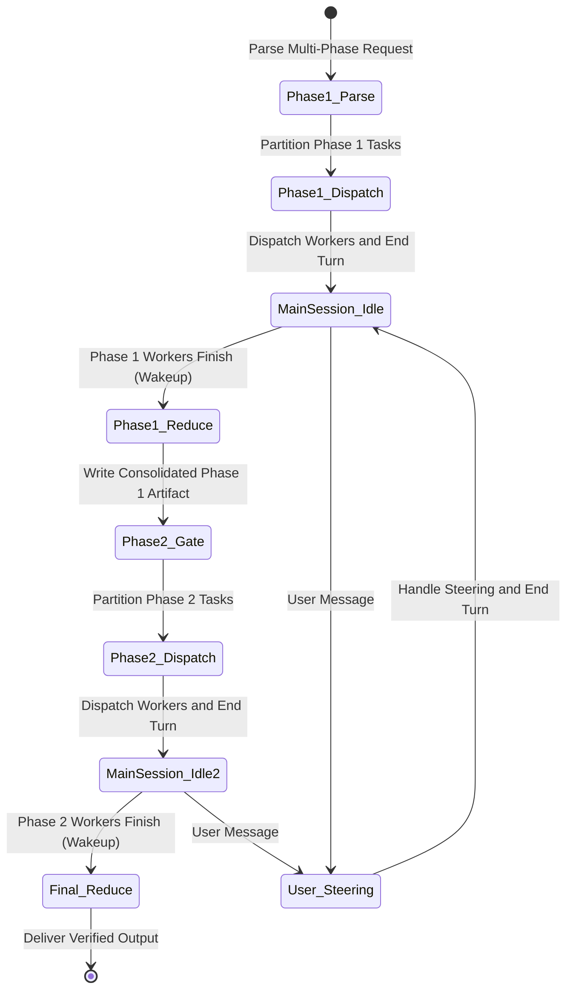

# Multi-phase parallel orchestration guide

This guide explains how to plan, run, and monitor **multi-phase parallel budgets** specified in a single request (such as `"plan with DOP 4 and implement with DOP 10"` or `"explore with parallel(auto), then implement with DOP 8"`).

---

## 1. Multi-phase syntax and concept

Complex pipelines often need different concurrency levels across stages. Early stages (scoping, planning, architecture) benefit from compact convergence with smaller or `auto` budgets, while execution stages (drafting, module builds, data processing) scale up to wider concurrency.

### Common multi-phase examples

```text
# Two-phase engineering pipeline
Plan architecture with DOP 4, then run implementation with DOP 10

# Three-phase publishing pipeline
Phase 1: research (DOP = 3); Phase 2: drafting (DOP = 6); Phase 3: review (DOP = 2)

# Hybrid auto-to-fixed pipeline
Explore options with parallel(auto), then implement modules with DOP 8
```

```text
+-------------------------------------------------------------------------+
|                  MULTI-PHASE BARRIER SYNCHRONIZATION                    |
|                                                                         |
|  [PHASE 1: Planning]   Budget: 5 Workers (or auto)                      |
|  Coordinator dispatches W1..W5 ===> ENDS TURN IMMEDIATELY               |
|  W1..W5 complete ===> Reactive wakeup of Coordinator                    |
|                                                                         |
|                       === PHASE 1 REDUCE BARRIER ===                    |
|                       Coordinator aggregates plan                       |
|                       (Optional Human Gate / Review)                    |
|                                                                         |
|  [PHASE 2: Execution]  Budget: 10 Workers                               |
|  Coordinator dispatches W1..W10 ===> ENDS TURN IMMEDIATELY              |
|  W1..W10 complete ===> Reactive wakeup of Coordinator                   |
|                                                                         |
|                       === FINAL REDUCE & DELIVERY ===                   |
+-------------------------------------------------------------------------+
```

---

## 2. The non-blocking phase state machine

To keep the main session unblocked for user input, the Coordinator never enters synchronous wait loops between phases.



### Protocol rules
1. **Fire-and-yield per phase:** At every dispatch boundary, launch that phase's workers and **end your turn immediately**.
2. **Barrier synchronization:** Phase `K + 1` starts only after all Phase `K` tasks complete and their deliverables are synthesized.
3. **No busy-wait polling:** Wait passively between dispatches; let the runtime wake the Coordinator when workers finish.
4. **Steering in flight:** If the user sends a message during Phase 1, respond immediately, redirecting or cancelling active workers without losing phase state.

---

## 3. State handoff between phases ("Document-First")

Never forward raw conversation transcripts or unbounded tool logs from Phase `K` into Phase `K + 1`.

### The document-first handoff pattern
1. **Consolidated artifact:** When Phase 1 completes, write a crisp specification or brief to disk (such as `specs/implementation_plan.md` or `briefs/master_research_brief.md`).
2. **Fresh worker contexts:** Launch Phase 2 workers as fresh, disposable subagents pointing directly to that artifact path.
3. **Benefits:**
   - **Zero context bloat:** Phase 2 workers avoid carrying Phase 1 dead ends and raw search logs.
   - **Traceability:** Phase 1 decisions live in a persistent artifact.
   - **Consistency:** Every Phase 2 worker builds against the exact same written contract.

---

## 4. Multi-phase pipeline patterns

### Pattern A: Plan -> Build -> Verify (3-tier pipeline)
- **Phase 1: Planning (`DOP = 3` or `auto`):**
  - Worker 1: Architecture spec and data models.
  - Worker 2: API routes and contracts.
  - Worker 3: Test matrix and edge cases.
  - *Barrier:* Coordinator merges into `docs/spec.md`.
- **Phase 2: Implementation (`DOP = 8`):**
  - Workers 1 to 6: Implement 6 decoupled modules against `docs/spec.md`.
  - Workers 7 to 8: Write package and integration tests.
  - *Barrier:* Coordinator runs integration verification.
- **Phase 3: Verification and Hardening (`DOP = 2`):**
  - Worker 1: Security and vulnerability sweep.
  - Worker 2: Performance and load check.
  - *Final Reduce:* Deliver verified system to user.

### Pattern B: Research -> Draft -> Review (content pipeline)
- **Phase 1: Research (`DOP = 4` or `auto`):**
  - Explore independent angles and save 4 research memos.
  - *Barrier:* Coordinator produces a unified editorial outline.
- **Phase 2: Drafting (`DOP = 6`):**
  - Draft 6 sections concurrently in `staging/`.
  - *Barrier:* Coordinator compiles the full draft.
- **Phase 3: Review (`DOP = 3`):**
  - Worker 1: Fact-check and citation audit.
  - Worker 2: Voice, tone, and readability check.
  - Worker 3: SEO and metadata review.
  - *Final Reduce:* Polish and deliver final manuscript.

---

## 5. Handling mid-flight user adjustments

Because the Coordinator stays unblocked, users can adjust multi-phase pipelines at any point:

1. **Phase cancellation:** User says *"Stop planning, proceed with approach X now."*
   - Coordinator cancels active Phase 1 workers, synthesizes findings collected so far, and immediately dispatches Phase 2.
2. **Budget reallocation:** User says *"Raise implementation budget from 10 to 16."* or *"Switch Phase 2 to auto."*
   - Coordinator updates the Phase 2 budget without disrupting active Phase 1 workers.
3. **Constraint injection:** User adds a requirement mid-run.
   - Coordinator merges the constraint into the Phase 1 synthesis artifact so Phase 2 inherits it cleanly.
