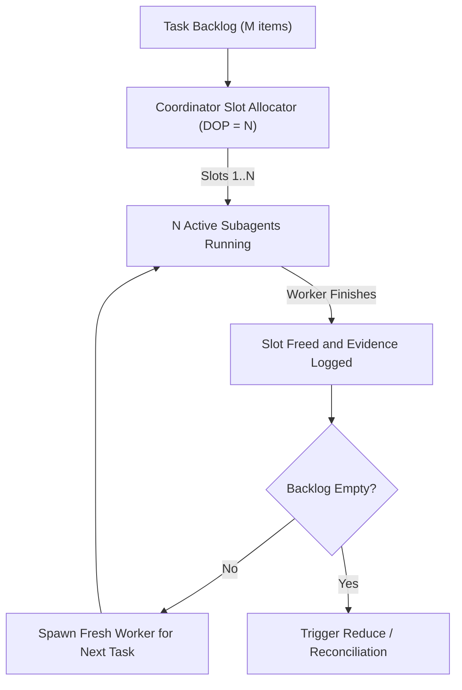

# Task decomposition and orthogonal partitioning guide

This guide details strategies for splitting any objective into independent, orthogonal work units for concurrent execution in parallel workflows.

---

## 1. Core philosophy: the orthogonal boundary principle

Parallel throughput depends on slice independence. Whenever subagents share mutable state or edit the same files, coordination bottlenecks and merge collisions erase the benefits of concurrency.

```text
+-------------------------------------------------------------+
|                     ROOT COORDINATOR                        |
|   - Analyzes objective & resolves DOP budget (N or auto)    |
|   - Defines strict disjoint boundaries                     |
|   - Dispatches workers & ends turn immediately              |
+-------------------------------------------------------------+
         |                       |                     |
         v                       v                     v
+-----------------+     +-----------------+   +-----------------+
| Worker 1        |     | Worker 2        |   | Worker 3        |
| Scope: Slice A  |     | Scope: Slice B  |   | Scope: Slice C  |
| Output: Out_A   |     | Output: Out_B   |   | Output: Out_C   |
+-----------------+     +-----------------+   +-----------------+
         |                       |                     |
         +-----------------------+---------------------+
                                 |
                                 v
+-------------------------------------------------------------+
|                     REDUCE PIPELINE                         |
|   - Gathers disjoint outputs Out_A, Out_B, Out_C            |
|   - Verifies integrity & reconciles dependencies            |
|   - Delivers synthesized final result to user               |
+-------------------------------------------------------------+
```

### Key tenets
1. **Disjoint Scopes:** Every worker owns an exclusive set of target files, topics, or data partitions.
2. **Single Writer Principle:** At most one subagent can hold write access to any given file or resource.
3. **Staged Output:** When multiple workers contribute to a single merged artifact, have each worker write to an isolated staging file (`staging/chunk_*.md` or distinct modules) for later reconciliation.
4. **Context Cleanliness:** Disposable workers start with clean contexts per slice, avoiding prompt dilution and cross-task drift.

### Sizing slices under `parallel(auto)`
When using `parallel(auto)` (`keyword = auto`), derive `DOP` directly from natural slice boundaries rather than picking an arbitrary number:
- Count the genuinely orthogonal slices (`K` independent packages, chapters, review lenses, or data shards).
- Merge tiny slices (such as single-file edits under a few lines) where spawn and Reduce cost outweighs parallel speedup.
- Split heavy or noisy slices (such as log-heavy debugging or large multi-source searches) so each worker preserves context isolation.

---

## 2. Universal domain decomposition matrix

Parallel partitioning applies to any domain:

| Domain | Partitioning Dimension | Work Unit Assigned to Subagent | Output Deliverable | Reduce / Reconciliation Action |
| :--- | :--- | :--- | :--- | :--- |
| **Research & Discovery** | Topic facet, search angle, source type, or competitor | Focused investigation of 1 facet or source domain | Structured memo (`research_<facet>.md`) with cited facts | Coordinator synthesizes findings, resolves conflicts, merges into brief |
| **Long-Form Writing** | Chapter, section, narrative angle, or case study | Draft 1 self-contained section against outline | Draft file (`draft_sec_<N>.md`) with citations | Coordinator harmonizes voice, transitions, and table of contents |
| **Code Implementation** | Subsystem, service, package, or isolated module | Implement 1 decoupled package against interface spec | Package files, local unit tests, test logs | Coordinator or integrator wires modules, removes stubs, runs full suite |
| **Code Review & Audits** | Security, performance, style, accessibility | Full codebase audit from 1 review perspective | Issue log with severity and line references | Coordinator merges logs into a deduplicated, prioritized matrix |
| **Data Processing & ETL** | Data shard, key range, date partition, file batch | Transform and analyze 1 shard or date block | Cleaned dataset, summary metrics, error log | Coordinator aggregates metrics and generates anomaly report |
| **Strategic Planning** | Scenario, risk category, persona, trade-off | Model 1 scenario or stakeholder impact | Scenario brief with impact and mitigations | Coordinator builds consolidated risk matrix and decision tree |
| **UI/UX & Design** | User journey step, viewport, design variation | Design 1 user flow, wireframe, or component spec | Layout spec, states, accessibility notes | Coordinator reconciles tokens, states, and shared component library |
| **Testing & QA** | Unit, integration, load, mutation testing | Author and run 1 test category | Test logs, failure traces, coverage stats | Coordinator aggregates coverage and summarizes regressions |

---

## 3. Partitioning patterns and strategies

### Pattern A: faceted or dimension slicing
Divide an objective by qualitative perspectives that naturally stay independent.
- **Example (Pull request review across 4 workers):**
  - Worker 1: Security audit (injection, auth checks, input sanitization).
  - Worker 2: Performance audit (algorithmic complexity, allocations, query N+1).
  - Worker 3: Architecture and maintainability (module boundaries, error handling).
  - Worker 4: Test coverage and edge cases (boundary inputs, failure paths).

### Pattern B: chunk or shard partitioning
Split a uniform list or dataset into contiguous blocks.
- **Formula:** For `M` work items and `DOP = N`, assign Worker `i` items `[ (i-1) * (M/N) + 1 ... i * (M/N) ]`.
- **Example (Migrating 40 config files with `DOP = 4`):**
  - Worker 1: Files 1 to 10
  - Worker 2: Files 11 to 20
  - Worker 3: Files 21 to 30
  - Worker 4: Files 31 to 40

### Pattern C: contract-first component isolation
When subtasks depend on shared interfaces, define a lightweight contract before dispatching parallel builders:
1. Coordinator writes `contracts/interface_spec.md` (function signatures, payloads, schemas).
2. Worker A implements the provider module conforming to the spec.
3. Worker B implements the consumer module against local contract fixtures.
4. Reduce wires the real provider and consumer together and verifies integration.

### Pattern D: persona or viewpoint slicing
When reviewing documentation, UX, or communication:
- Worker 1: Newcomer persona (checks clarity, undefined terms, prerequisites).
- Worker 2: Systems architect persona (checks scalability, edge cases, failure recovery).
- Worker 3: Product manager persona (checks user outcomes and friction points).

---

## 4. Resource and file ownership protocols

Eliminate write races with explicit file boundaries:

### 1. The workspace ownership rule
```text
# Good: Explicit disjoint paths
Worker 1: writes to docs/sections/01_introduction.md
Worker 2: writes to docs/sections/02_architecture.md
Worker 3: writes to docs/sections/03_benchmarks.md

# Bad: Shared write target
Worker 1, 2, and 3 all edit docs/whitepaper.md directly (FORBIDDEN)
```

### 2. The staging directory pattern
When workers build pieces that will merge into one output file:
1. Create a staging folder (`staging/` or `.parallel_staging/`).
2. Have each worker write exclusively to `staging/chunk_<worker_id>.<ext>`.
3. Reconcile staged files during Reduce, copy into the final file, and delete the staging directory.

---

## 5. Work queueing and drip-feeding (`Tasks > DOP`)

When total work items `M` exceed the budget `N` (`M > N`):



### Queue management rules
1. **Initial dispatch:** Launch `N` subagents up to the resolved `DOP` budget.
2. **Reactive refill:** As soon as a worker finishes and frees a slot, dispatch a fresh worker for the next queued item.
3. **Fresh context per slice:** Spawn a new worker rather than reusing completed ones across unrelated tasks.
4. **No busy-waiting:** End your turn between dispatch waves and let worker completion trigger the next wakeup.

---

## 6. The universal Reduce (reconciliation) protocol

Once all parallel workers finish, run Reduce:

```text
[ Parallel Stream Completion ]
              |
              v
     1. Ingestion & Audit
        Verify all N worker deliverables arrived
        Verify zero leftover stubs or TODOs
              |
              v
     2. Reconciliation & Merge
        Assemble staged files into final deliverable
        Wire interfaces or combine analysis matrices
              |
              v
     3. Verification & Validation
        Run builds, linters, and test suites
        Verify flow, consistency, and citations
              |
              v
     4. Final Delivery to User
        Summarize execution counts
        Present verified artifacts
```

### Reduce checklist
- [ ] All `N` worker reports received and verified.
- [ ] Zero leftover placeholders (`TODO`, `FIXME`, or mock stubs) in final outputs.
- [ ] Imports, cross-references, and citations validated across slices.
- [ ] Full build, test, or lint check green.
- [ ] Temporary staging directory removed.
