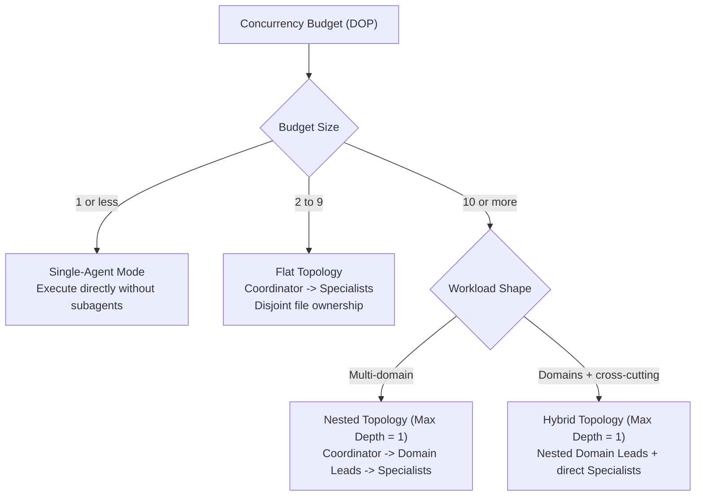

# Hierarchical swarm coding

`swarm-coding` divides multi-system software builds across an explicit organization chart (`Coordinator -> Domain Leads -> Specialists`) of specialized subagents. Each subagent receives a narrow, exclusive scope so large features and cross-cutting refactors ship without context bloat or cross-package breakage.

---

## 1. Roles and boundaries

Every agent in the hierarchy holds one of three roles:

| Role | Count | Writes code or runs shell commands? | Allowed scope | Responsibility |
| :--- | :--- | :--- | :--- | :--- |
| **Swarm Coordinator (root)** | `1` | **Never** (writes top-level `docs/*.md` specs only) | Subagent spawning and management, `docs/` spec authoring, user Q&A | Designs the org chart, allocates concurrency budgets, writes system contracts, handles all user questions, and runs the final Reduce phase. |
| **Domain Lead** | `N` (one per subsystem) | **Never** (writes domain `docs/*.md` specs only) | Subagent spawning, codebase search and read, `docs/` spec authoring | Loads `references/lead.md`, writes domain contracts, partitions tasks with disjoint file boundaries, spawns Specialists, and verifies domain output. |
| **Specialist** | `1..K` per domain | **Yes** (within assigned target files only) | File read and write, shell execution, package test and lint runners (no subagent spawning) | Implements one scoped task, runs package-scoped tests and linters, returns terminal proof to its parent, and exits to free its slot. |

---

## 2. Sizing and concurrency budget (`DOP`)

The **agent budget** (`DOP`) caps how many subagents may run at the same time across the hierarchy:

- **Default budget**: Use the concurrency count requested by the user, or default to **`10`** active subagents if unspecified.
- **Single-agent guard (`DOP <= 1`)**: If the user sets a budget of `1` or less, skip subagent spawning, tell the user single-agent mode is active, and execute the work directly.
- **Slot accounting**: In nested teams, each Domain Lead occupies `1` active slot, leaving **`DOP - 1` concurrent Specialist slots** in its slice (`8` slots = `1` Lead + up to `7` active Specialists).
- **Slot recycling & backlog drip-feeding**: Finished Specialists free their slots right away. When tasks outnumber slots, the Lead keeps a queue and launches the next fresh Specialist as each active worker reports back.

Keep nesting depth at **`1` maximum** (`Coordinator -> Domain Leads -> Specialists`). Never add sub-leads below a Domain Lead; widen the Lead's slot slice or drip-feed from its task queue instead.

---

## 3. Map-Reduce execution workflow

Run every build as a two-phase **Map-Reduce** pipeline:

### Phase 1: Map (spec-first parallel build)
- [ ] **Write contracts first**: Draft top-level interfaces, schemas, and module boundaries in `docs/` before spawning workers.
- [ ] **Partition ownership (Single Writer rule)**: Give every Specialist an exclusive list of files to create or edit. When multiple workers contribute to one shared file or config, assign isolated staging files (`staging/chunk_*.md`) for Reduce to merge.
- [ ] **Spawn and yield**: Launch Leads (or direct Specialists in flat mode) in parallel and end your turn right away so you stay responsive to user messages and wake when workers report back. Never poll status or sleep in a loop.
- [ ] **Keep communication vertical**: Messages and results flow strictly between parent and child (`Coordinator <-> Lead <-> Specialist`). Subagents do not prompt the user directly; ambiguities travel up to the Coordinator, which asks the user and relays the answer back down.
- [ ] **Run package-scoped checks only**: During Map, Specialists run targeted compiler and package tests (`go test ./internal/auth/...`, `pytest tests/test_auth.py`). Broad root test sweeps (`go test ./...`, `npm test`) wait until Reduce so concurrent edits in sibling packages do not cause false failures.

### Phase 2: Reduce (reconciliation and verification)
Parallel streams often use interface stubs or staged files while sibling modules are in flight. Before reporting completion to the user, the Coordinator spawns a dedicated **Integration / QA Specialist** to finish Reduce:

- [ ] **Purge stubs and staging files**: Merge any `staging/` outputs, wire real implementations together, and verify zero leftover `TODO` markers, dummy returns, or temporary adapters remain.
- [ ] **Run full-project verification**: Execute root builds, full test suites, and linters across the whole repository and return terminal output to the Coordinator as proof.

---

## 4. Briefing essentials (zero ambient context)

Every subagent starts with an empty conversation history and knows nothing about your chat or `swarm-coding` rules unless told in its task prompt:

1. **Coordinator -> Domain Lead brief**:
   - Instruct the Lead to read `SKILL.md` and `references/lead.md` as Step 1.
   - State its domain scope, reference contracts in `docs/`, forbid production code edits and shell builds or tests, give its exact `DOP` slice (`1` Lead + `DOP - 1` Specialists), and require non-blocking parallel Specialist dispatch.
2. **Lead (or Coordinator) -> Specialist brief**:
   - State the exact task, exclusive target files (and off-limits paths), reference contract path in `docs/`, exact package-scoped test and lint commands, fail-fast rule (zero fallbacks or mock data), and instruction to return terminal test output before exiting.

---

## 5. Failure traps to avoid

1. **Missing subagent permissions on Leads**: Spawning a Domain Lead without subagent-spawning access leaves it unable to assemble its Specialist team.
2. **Coordinator or Lead drift into coding**: Once `swarm-coding` is active, follow-up user requests go through the swarm. Coordinators and Leads never edit source code or run build and test commands themselves.
3. **Concurrent edits to the same file**: Never assign two active Specialists to edit the same file. Partition files cleanly or stage partial outputs in `staging/` for Reduce to merge.
4. **Root test sweeps during Map**: Running `go test ./...` or `npm test` while sibling packages are half-written creates noisy false failures. Save full-repo test runs for the Reduce QA Specialist.
5. **Skipping Reduce**: Never ship code to the user before an Integration / QA Specialist removes temporary stubs and runs end-to-end verification.
6. **Polling or sequential spawning**: Never launch independent workers one-by-one sequentially, and never sit in `sleep` or status-polling loops.

---

## 6. Role playbooks and templates

Load only the reference matching your active role:

- **`references/coordinator.md`**: Load when acting as the root **Swarm Coordinator**; includes the setup checklist, copy-paste Lead briefing template, and Reduce verification steps.
- **`references/lead.md`**: Load as Step 1 when spawned as a **Domain Tech Lead**; includes backlog drip-feeding rules and the copy-paste Specialist briefing template.
- **`references/specialist.md`**: Load when acting as a **Specialist** that needs the full validation loop and definition-of-done checklist.
- **`assets/agents/lead-agent.md` & `assets/agents/specialist-agent.md`**: Reusable system-prompt templates for `lead-agent` and `specialist-agent`.
