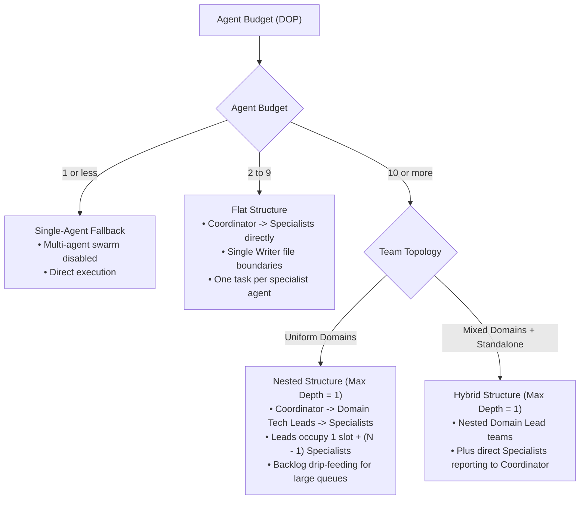
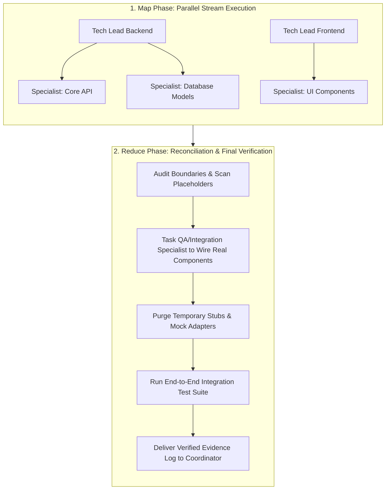
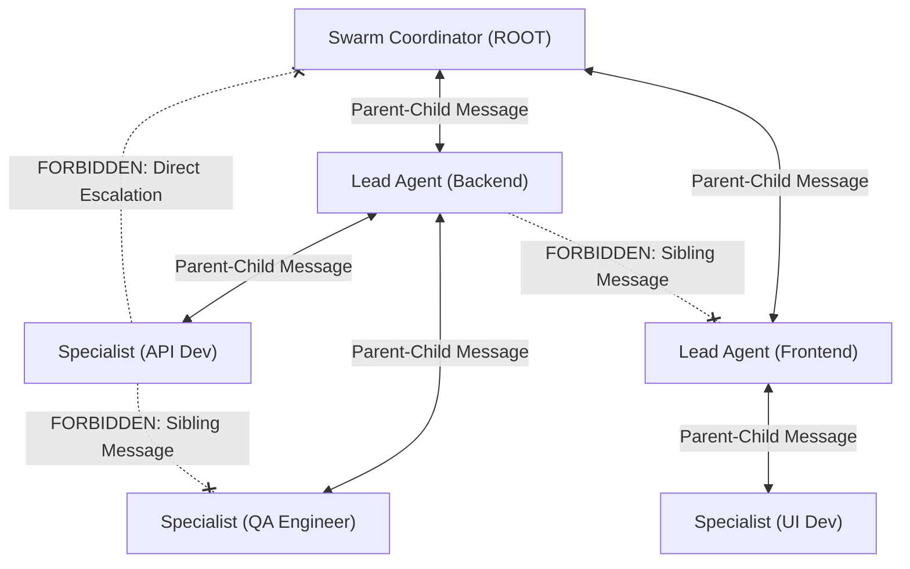

# Swarm Coding

Swarm Coding divides complex engineering objectives among specialized subagents structured in a clear organization chart. This divide-and-conquer strategy guarantees context isolation, prevents cross-domain contamination, and accelerates delivery by keeping each subagent's scope narrow and exclusive.

> [!NOTE]
> In this guide, the terms "agent" and "subagent" are used interchangeably.

---

## ⚡ Core Principles & Operational Rules

### 1. Invocation Syntax & Budget Parsing
Parse the user's prompt to extract the target **Agent Budget / Degree of Parallelism (`DOP`)**:
- `swarm-coding(N)` or `/swarm-coding(N)` (e.g., `swarm-coding(8)`, `/swarm-coding(12)`)
- `/swarm-coding <DOP>` or `/swarm <DOP>` (e.g., `/swarm-coding 10`, `/swarm 6`)
- `/swarm-coding dop: <number>` or `/swarm-coding budget <number>` (e.g., `/swarm-coding dop: 8`, `/swarm-coding budget 6`)
- **Natural language budgets** (e.g., *"swarm this refactor across 8 agents"*, *"run a coding swarm with a budget of 12"*)
- If no number is provided, default to **10**. If `DOP <= 1`, fall back to direct single-agent execution.

### 2. Coordinator & Lead Non-Execution
- The ROOT Swarm Coordinator and Domain Lead Agents ALWAYS remain coordinators/architects and NEVER fall back to code executors.
- Both Coordinator and Lead Agents are strictly forbidden from writing production implementation code, running tests or builds, or calling `run_command`.
- Lead Agents have `EnableWriteTools: true` **solely** to draft or update markdown specification files (such as `docs/domain-spec.md`). Writing production source files or running terminal commands in a Lead Agent is a critical protocol violation.

### 3. Split Swarm Profiles
- **Swarm Coordinator (ROOT):** Attributed strictly to the ROOT agent that activated the skill (Multiplicity: 1). Defines the top-level **Org Chart**, names Lead Agents, allocates the agent budget, writes top-level architecture specs, and orchestrates the final Reduce phase.
- **Lead Agent (Domain Tech Lead):** Attributed to domain or system leads (Multiplicity: N, one per system/domain). Loads the `swarm-coding` skill as its mandatory Step 1, writes domain specifications, defines and spawns its Specialist team within its allocated sub-budget, and integrates domain deliverables.
- **Specialist:** Attributed to task executors. Designs and implements narrowly-scoped components within a single domain, adhering to domain specs and running localized validation loops.

### 4. Single Writer Principle & Staging Pattern
- **Single Writer Principle:** Only one Specialist is granted write authority to any single file or resource at a time. Disjoint file ownership prevents concurrent write collisions.
- **Staging Pattern:** When outputs from multiple workers must combine into a shared contract, configuration, or unified module, workers output to isolated staging files (`staging/chunk_*.md` or scoped temporary files), which the Lead Agent or Integration Specialist reconciles during the Reduce phase.

### 5. Strict Vertical Communication (No Lateral Crosstalk)
- **Allowed:** Messaging between immediate parents and children ONLY (`Swarm Coordinator <-> Lead Agent`, `Lead Agent <-> Specialist`, or `Swarm Coordinator <-> Specialist` in flat/hybrid structures).
- **Forbidden:** Direct communication between agents on the SAME layer (`Lead <-> Lead`, `Specialist <-> Specialist`) or direct escalation (`Specialist <-> Swarm Coordinator` bypassing an intermediate Lead Agent) is strictly forbidden.
- **Design Document First:** Cross-domain coordination MUST be handled by writing or updating shared design documents first, then notifying parent/child agents via `send_message`.

### 6. Fine-Grained Targeted Testing (No Broad Root Sweeps)
Specialists MUST execute fine-grained, package-scoped unit tests (e.g., `go test ./internal/physics/...`) strictly targeting their assigned task. Running broad project-root test commands (e.g., `go test ./...`) is strictly forbidden for Specialists unless explicitly requested by the Swarm Coordinator during the final Reduce phase, preventing cross-task contamination and false failures while peer agents work concurrently.

### 7. Mandatory Skill Onboarding & Team Assembly (Zero Ambient Knowledge)
- Subagents spawn with a blank context window and have **zero ambient understanding** of the `swarm-coding` skill, DOP arithmetic, non-execution rules, or how to call `define_subagent` and `invoke_subagent`.
- Merely stating *"you are a swarm coding lead"* or *"you have a budget of X"* causes Lead Agents to fail to assemble their teams and write code themselves.
- **Coordinator -> Lead Propagation:**
  1. Configure Lead Agents with `EnableSubagentTools: true`, `EnableWriteTools: true`, and `EnableMCPTools: true`.
  2. Mandate **Step 1 (Load Skill)**: Instruct the Lead Agent to immediately read/load the `swarm-coding` skill (`SKILL.md` and `references/lead.md`) before taking any other action.
  3. Supply the **exact `define_subagent` and `invoke_subagent` tool schemas** and budget arithmetic (`1 slot for Lead + (DOP - 1) concurrent Specialists`) in the Lead's initial briefing prompt.
- **Lead -> Specialist Propagation:** The Lead MUST configure Specialists with `EnableWriteTools: true` and `EnableSubagentTools: false`, and provide explicit file ownership boundaries, localized test commands, fail-fast rules, and instructions to report terminal proof via `send_message` before terminating.

---

## 🎯 Agent Budget & Degree of Parallelism (DOP)

* **Definition**: **Agent Budget** is synonymous with **Degree of Parallelism (DOP)**. It defines the maximum number of **active, concurrent subagents** allowed to execute at the exact same time across the entire swarm hierarchy.
* **Budget Arithmetic & Slot Accounting**:
  - `Domain Budget (DOP) = 1 (Lead Agent) + (DOP - 1) (Concurrent Specialists)`.
  - The Lead Agent consumes 1 concurrency slot. For example, if a Lead is allocated a budget slice of 8, it occupies 1 slot and can run up to **7 concurrent Specialists** simultaneously.
* **Active vs. Past Capacity (Slot Recycling)**: Completed or terminated subagents do **not** consume budget. When a Specialist completes its work and terminates, its concurrency slot is immediately freed back to the domain pool.
* **Backlog Drip-Feeding**: When domain tasks exceed available specialist slots (`DOP - 1`), the Lead Agent maintains a domain task backlog and drip-feeds tasks to fresh Specialists as active workers finish.
* **Default Concurrency**: Assumes a default budget of **10** active concurrent agents if omitted by the user.
* **Low Budget Guard (<= 1):** If the user specifies an `agent budget <= 1`, multi-agent orchestration is disabled. Automatically fall back to direct single-agent execution without spawning subagents, notifying the user: *"Agent budget is set to <= 1; running in direct single-agent execution mode. To enable swarm parallelism, specify an agent budget > 1 (default: 10)."*
* **Swarm Shapes (Flat, Nested, Hybrid)**:
  - **Flat (Budget < 10)**: Swarm Coordinator coordinates Specialists directly (no intermediate Tech Leads).
  - **Nested (Budget >= 10, Max Depth = 1)**: Swarm Coordinator assigns Domain Tech Leads and allocates each a slice of the agent budget (`Coordinator -> Domain Tech Leads -> Specialists`). Never add deeper sub-lead layers; scale wider or drip-feed from the domain backlog.
  - **Hybrid**: Combines nested domain teams with flat direct specialists reporting to the Coordinator for standalone or cross-cutting tasks.

### 🌲 Swarm Sizing Decision Tree



#### Decision Rules:

1. **Agent Budget < 10 -> Flat Structure**:
   - Coordinator coordinates Specialists directly (no intermediate Tech Leads).
   - Partition tasks with strict Single Writer file boundaries and assign one task to each Specialist.
2. **Agent Budget >= 10 -> Nested Structure (Max Depth = 1)**:
   - Assign one Domain Tech Lead per technical domain and allocate each a slice of the agent budget (**each Tech Lead counts as 1 slot**).
   - **Maximum Nesting Depth is strictly 1** (`Coordinator -> Domain Tech Leads -> Specialists`). Do not spawn Sub-Leads or Component Leads; even for large budgets (20+), Domain Leads manage their concurrency slice directly and drip-feed tasks from a backlog as Specialists finish.
3. **Hybrid Structure (Mixed Workloads)**:
   - Combine nested domain teams (`Coordinator -> Domain Lead -> Specialists`) with direct Specialists (`Coordinator -> Specialist`) for focused, standalone, or cross-cutting tasks (such as the final Integration/QA Specialist).

---

## 📡 Non-Blocking Coordinator & Reactive Concurrency

The Swarm Coordinator is the primary user interface and top-level organizational conductor. It must remain **unblocked >= 99% of the time** to receive steering comments, scope modifications, and status requests from the user.

1. **Role Separation (Delegation over Execution):**
   - The Swarm Coordinator acts like an engineering director: it breaks down epics, writes top-level architectural contracts, and manages the org chart. It **never** blocks itself with sequential coding, manual building, or terminal test runs.
2. **Fire-and-Yield Concurrency:**
   - When the Coordinator spawns Lead Agents via `invoke_subagent`, it **immediately halts tool calls to end its turn**. It never loops, sleeps, or polls.
3. **Always Unblocked for User Steering & Status Inquiries:**
   - Because the Coordinator never enters busy-wait polling loops, it is permanently available to process incoming user messages while the swarm works in the background:
     - **Status Inquiries**: The Coordinator can immediately provide live progress updates or inspect active workers via `manage_subagents (Action="list")`.
     - **In-Flight Steering / Scope Changes**: If the user provides new constraints or changes requirements mid-run, the Coordinator can steer active Lead Agents via `send_message` or cancel/restart them via `manage_subagents (Action="kill")`.
4. **Sole User Escalation Interface:**
   - Subagents do not possess `ask_question`. All requirement ambiguities or design trade-offs encountered by Specialists are messaged up to their Tech Lead, who routes them to the Swarm Coordinator via `send_message`. The Coordinator prompts the user with `ask_question` and relays decisions back down the hierarchy.

---

## 🔄 Map-Reduce Workflow & The "Reduce" (Reconciliation) Step

Swarm Coding operates as a two-stage **Map-Reduce** engineering pipeline:



### 1. Map Phase (Parallel Development & Collision Avoidance)
* **Single Writer File Ownership**: Assign each Specialist an exclusive set of target files. Only one subagent may hold write authority to any single file at a time.
* **Staging Pattern**: When multiple workers contribute to a shared module, schema, or document, have them write to isolated staging files (`staging/chunk_*.md` or scoped temporary files) for the Lead Agent or Integration Specialist to merge during Reduce.
* **Tech Lead Arbitration**: Domain Tech Leads dynamically arbitrate file boundaries and dependencies among their specialists as changes evolve.
* **Temporary Interface Contracts**: When Specialist A depends on in-progress work from Specialist B, they program against agreed interface stubs or mocks defined in the domain specification.

### 2. The Final "Reduce" Phase (Integration & Placeholder Purge)
Parallel execution often leaves behind temporary mocks, stubs, or staged chunks where real implementations were created by peer agents. Before declaring success, the Coordinator orchestrates the final **Reduce** step:

1. **Placeholder & Stub Audit**: Scans code boundaries to ensure no dangling `TODO` comments, dummy return values, or temporary mock adapters survive.
2. **Reconciliation & Real Component Wiring**: The Coordinator tasks a designated **Integration/QA Specialist** to merge staged files and connect all real modules together.
3. **End-to-End Project Verification**: The QA Specialist runs full project builds, integration tests, and linters, reporting actual terminal proof back to the Coordinator before final delivery to the user.

---

## 👥 Mechanics and Roles

Subagents in a Swarm Coding session assume one of three roles:

1. **Swarm Coordinator (ROOT)** [Multiplicity: 1]
   - Acts as top-level architect and organizational manager.
   - Defines the **Org Chart**, names Lead Agents for each domain, allocates agent budgets, and writes top-level architecture specs.
   - **Persistence & Non-Execution:** Strictly forbidden from executing code or running build/test commands.
   - **Sole User Interface:** Sole agent in the swarm authorized to interact with the user via `ask_question`.
2. **Lead Agent (Domain Tech Lead)** [Multiplicity: N]
   - Technical lead for a specific domain or system (e.g., Frontend, Backend, Database).
   - **Mandatory Step 1:** Immediately loads the `swarm-coding` skill (`SKILL.md` and `references/lead.md`) into context upon startup.
   - Writes domain specs ("Design Document First"), defines the `specialist` subagent via `define_subagent`, spawns Specialists via `invoke_subagent` within its allocated sub-budget, arbitrates file boundaries, and integrates deliverables.
   - **Tool Restrictions:** Configured with `EnableSubagentTools: true`, `EnableWriteTools: true` (strictly for writing `docs/*.md` specification files only), and `EnableMCPTools: true`. Strictly forbidden from editing production code or calling `run_command`. Routes user questions up to the Swarm Coordinator via `send_message`.
3. **Specialist (Task Implementer / QA)** [Multiplicity: N]
   - Ephemeral and task-scoped (disposable worker). Operates with a clean, focused context window dedicated strictly to its assigned task.
   - Configured with `EnableWriteTools: true`, `EnableMCPTools: true`, and `EnableSubagentTools: false`.
   - Follows domain specifications, executes the operational validation loop (build, package-scoped test, lint, format), replaces stubs, and sends proof-of-validation logs to its parent Lead Agent before terminating.

### 🛠️ Subagent Configuration & Runtime Tool Schemas

When spawning subagents at runtime with `define_subagent` and `invoke_subagent` (or via static agent definitions in `assets/agents/*.md`), follow these exact configurations:

* **Model Configuration (`Model: "inherit"`)**:
  Always pass `Model: "inherit"` in `invoke_subagent` (and `model: inherit` in static definitions) so subagents adopt the parent session's model and reasoning effort without configuration drift.
* **Customization & MCP Inheritance**:
  Set `EnableMCPTools: true` in `define_subagent` (and `inheritCustomizations: true`, `inheritMcp: true` in static definitions) so subagents retain project rules, domain linters, and MCP servers.
* **Coordinator -> Defining & Invoking Lead Agents**:
  The Coordinator MUST enable subagent tools (`EnableSubagentTools: true`) so Lead Agents have the `define_subagent`, `invoke_subagent`, and `manage_subagents` tools required to assemble their teams:
  ```json
  // 1. Coordinator defines the lead-agent type
  {
    "Name": "lead-agent",
    "Description": "Domain Tech Lead that authors domain specs and orchestrates Specialist subagents.",
    "EnableSubagentTools": true,
    "EnableWriteTools": true,
    "EnableMCPTools": true,
    "SystemPrompt": "You are a Domain Tech Lead in a Swarm Coding session. Step 1: Load the swarm-coding skill and references/lead.md immediately. You may use write_file/edit_file ONLY to author markdown specifications in docs/. You are strictly forbidden from writing production code or calling run_command. You must define and invoke Specialist subagents for all code implementation and testing."
  }
  ```
* **Lead Agent -> Defining & Invoking Specialists**:
  Each Lead Agent defines the `specialist` worker type with `EnableWriteTools: true` and `EnableSubagentTools: false`, then spawns up to `(DOP - 1)` concurrent Specialists:
  ```json
  // 1. Lead Agent defines the specialist type
  {
    "Name": "specialist",
    "Description": "Specialist worker that implements scoped code tasks and runs package-scoped validation.",
    "EnableSubagentTools": false,
    "EnableWriteTools": true,
    "EnableMCPTools": true,
    "SystemPrompt": "You are a Specialist worker in a Swarm Coding session. Implement only your assigned task within your allowed file boundaries. Run package-scoped unit tests only (never broad root sweeps). Never add fallbacks or mocks for live data. Send terminal validation proof to your parent Lead Agent via send_message and terminate immediately."
  }
  ```

---

## 📋 Swarm Briefing Protocols & Canonical Prompt Templates

Subagents start with a blank conversational context and do not automatically load the `swarm-coding` skill or know how to call `define_subagent` and `invoke_subagent`. Coordinators and Leads must supply complete, self-contained briefings using the templates below.

### 1. Coordinator -> Lead Agent Briefing Protocol

When the Swarm Coordinator spawns a Lead Agent via `invoke_subagent(TypeName: "lead-agent", Model: "inherit", ...)`, the `Prompt` MUST follow this structure:

```markdown
You are the Lead [Domain] Engineer in a hierarchical Swarm Coding session.

### Step 1: Mandatory Skill Onboarding (Execute First)
Before taking any other action, load the `swarm-coding` skill (and its `references/lead.md` playbook) into your context so you have full awareness of Swarm Coding rules and protocols.

### Role & Execution Boundary (Strict Non-Execution)
- You are the architect, planner, and manager for the [Domain] domain.
- Your `write_file` and `edit_file` tools are enabled **strictly** for drafting or updating markdown specification files in `docs/`.
- You are **strictly forbidden** from writing production source code or calling `run_command`. All code changes, package installations, builds, and test runs MUST be delegated to Specialist subagents that you spawn.

### Agent Budget & Concurrency Mechanics (DOP: [N])
- Your allocated domain budget is [N] concurrent agents.
- You occupy 1 concurrency slot, leaving **[N - 1] active concurrent Specialist slots**.
- Concurrency slots recycle immediately when a Specialist finishes and terminates.
- If your epic has more than [N - 1] tasks, maintain a domain task backlog and drip-feed tasks to fresh Specialists as active workers complete.

### Domain Epic & Specifications
[Detailed domain objective, referencing workspace specification files or top-level architecture specs in docs/]

### How to Assemble & Run Your Specialist Team
1. **Specification First**: Draft or update your domain API/data contracts in `docs/` using `write_file` or `edit_file`.
2. **Task Deconstruction (Single Writer Principle)**: Break the epic into independent tasks with disjoint file boundaries so only one Specialist writes to any file at a time (or use `staging/` files for shared outputs).
3. **Define the Specialist Subagent**: Call `define_subagent` with:
   - `Name`: `"specialist"`
   - `Description`: `"Domain Specialist worker for code implementation and localized testing."`
   - `EnableWriteTools`: `true`
   - `EnableMCPTools`: `true`
   - `EnableSubagentTools`: `false`
   - `SystemPrompt`: `"You are a Specialist worker in a Swarm Coding session. Edit only your assigned target files, run localized package tests only, fail fast without fallbacks, send terminal validation proof via send_message, and terminate immediately."`
4. **Spawn Specialists (`invoke_subagent`) & Yield**: Invoke up to [N - 1] Specialists concurrently with `TypeName: "specialist"` and `Model: "inherit"`, supplying each with its target files, forbidden boundaries, and localized test command. **Immediately stop calling tools after `invoke_subagent`** to yield your turn and wait reactively for Specialist completion messages.
5. **Domain Reconciliation & Escalation**: Verify that Specialists replace all temporary stubs with real implementations, review their terminal validation logs, and report completion to the Swarm Coordinator via `send_message`. Route any requirement ambiguities to the Swarm Coordinator via `send_message` (you do not have `ask_question`).
```

### 2. Lead Agent -> Specialist Briefing Protocol

When a Lead Agent spawns a Specialist via `invoke_subagent(TypeName: "specialist", Model: "inherit", ...)`, the `Prompt` MUST follow this structure:

```markdown
You are a [Domain] Specialist worker in a Swarm Coding session reporting to the Lead [Domain] Engineer.

### Assigned Scope & Single Writer File Boundaries
- Task: [Explicit description of the granular task]
- Exclusive Target Files: [Explicit list of allowed files to create/edit — you are the Single Writer for these files]
- Staging Path (if shared): [Optional staging/chunk_*.md path if output must be merged later]
- Forbidden Boundaries: Do NOT touch files outside your assigned list. If you depend on contracts from other modules, use the agreed interfaces in [spec path].

### Execution & Validation Rules
1. Scoped Validation: Run ONLY localized package/file tests (e.g., `npm test path/to/test` or `go test ./pkg/...`). NEVER run full-repository root commands like `npm test` or `go test ./...` which pollute other concurrent workers.
2. Fail Fast & No Fallbacks: Never introduce fallback mechanisms, mock modes for live data, or silent error suppression. Always fail fast with rich diagnostics.
3. Proof & Completion: Once implementation passes tests and linters, send your terminal validation output to your parent (Lead [Domain] Engineer) via `send_message`, then terminate immediately to release your concurrency slot.
```

---

## 💬 Communication Hierarchy & Rules



1. **Vertical Parent-Child Messaging ONLY:**
   - Swarm Coordinator <-> Lead Agent
   - Lead Agent <-> Specialist
2. **Forbidden Lateral Communication:**
   - Communication between agents on the SAME layer (Lead <-> Lead, Specialist <-> Specialist) is strictly forbidden.
   - Specialists MUST NOT message the Swarm Coordinator directly.
3. **Specification-Driven Coordination ("Design Document First"):**
   - When a change in Domain A impacts Domain B, Lead Agent A updates the shared design document in the workspace, then messages the Swarm Coordinator. The Swarm Coordinator reviews and notifies Lead Agent B.

---

## ⚠️ Gotchas & Antipatterns

1. **The Unonboarded Lead Trap:** Spawning a Lead Agent without instructing it to load the `swarm-coding` skill as Step 1 and without providing the exact `define_subagent` / `invoke_subagent` tool schemas. Without explicit onboarding and tool schemas, Leads fail to assemble their teams.
2. **The Missing `EnableSubagentTools` Trap:** Defining a `lead-agent` with `EnableSubagentTools: false` (or omitting it). Without `EnableSubagentTools: true`, the Lead Agent lacks `define_subagent` and `invoke_subagent` and cannot spawn Specialists.
3. **The Lead-As-Coder Trap:** Prompting a Lead Agent with individual coding instructions or allowing a Lead Agent to use its `write_file`/`edit_file` tools on production code instead of `docs/*.md` specs, or calling `run_command`.
4. **The Write Collision Trap:** Allowing multiple Specialists to edit the same file concurrently. Enforce the Single Writer Principle or use isolated `staging/` files reconciled during Reduce.
5. **The Customization Stripping Trap:** Setting `EnableMCPTools: false` or `inheritCustomizations: false` on subagents, which strips away project rules (fail-fast, no fallbacks), linters, and installed skills.
6. **The Coordinator-to-Executor Fallback Trap:** Once activated, the Swarm Coordinator MUST NOT interpret user follow-up messages as permission to write code or execute tasks directly. Treat all messages as requests *to the swarm*.
7. **Leftover Placeholder / Staging Trap:** Delivering code where temporary stubs, mocks, or unmerged `staging/` files survive into the final codebase. Always execute the Reduce phase to purge stubs and wire real implementations.
8. **Under-Utilization Mismatch:** Spawning too few agents or failing to utilize Lead Agents when the agent budget (`DOP >= 10`) and task scope call for domain delegation.
9. **Sibling Messaging Trap:** Attempting to send direct messages between peer Lead Agents or peer Specialists. Always route cross-component updates through shared design documents and hierarchical parent-child messages.
10. **The Long-Running Agent Context-Pollution Trap:** Retaining Specialists across multiple unrelated tasks accumulates noisy tool logs and token bloat. Spawn fresh, disposable Specialists with clean context windows per task.
11. **The Root Test Contamination Trap:** Running broad project-root test commands (e.g., `go test ./...`) while parallel agents are modifying other packages causes false test failures. Specialists must scope test commands strictly to their assigned package until the final Reduce step.
12. **Passive Polling Loops:** Coordinator and Lead agents must never poll subagent statuses in a tight loop; always halt tool calls after `invoke_subagent` and rely on automatic reactive wakeup.

---

## 📚 Progressive Disclosure & References

- **Swarm Coordinator Reference**: [`references/coordinator.md`](references/coordinator.md) — Root coordinator responsibilities, org chart design, unblocked posture, and the Reduce step.
- **Lead Agent Reference**: [`references/lead.md`](references/lead.md) — Domain tech lead responsibilities, dynamic collision arbitration, and sub-team management.
- **Specialist Reference**: [`references/specialist.md`](references/specialist.md) — Task execution, operational validation loop, stub replacement, and proof-of-correctness reporting.
- **Bundled Lead Agent Template**: [`assets/agents/lead-agent.md`](assets/agents/lead-agent.md) — Standard subagent definition for domain leads.
- **Bundled Specialist Agent Template**: [`assets/agents/specialist-agent.md`](assets/agents/specialist-agent.md) — Standard subagent definition for specialist workers.
