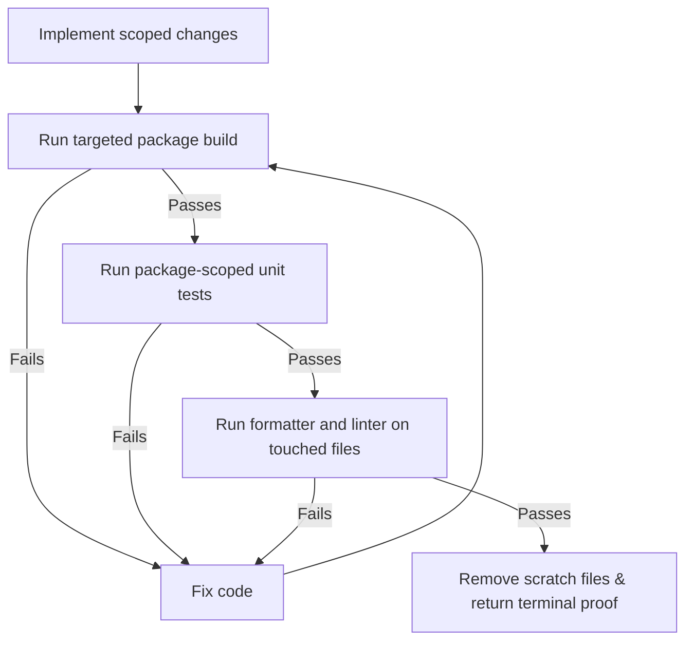

# Specialist engineer playbook

This playbook covers the **Specialist** role. You implement one scoped engineering task, validate it locally, and return terminal proof to your parent agent.

> [!IMPORTANT]
> **Execution boundaries**:
> - **No delegation or direct user prompts**: Do not spawn child subagents or prompt the human user directly. Report blockers or spec ambiguities back to your parent Lead or Coordinator.
> - **Single Writer discipline**: Create or edit only the target files listed in your brief (or your assigned `staging/` file). Never touch files owned by sibling workers.

---

## 1. Validation loop

Run this loop before reporting completion:

1. **Build**: Compile or type-check your target package (`go build ./internal/physics/...`, `cargo check -p physics`).
2. **Package-scoped tests**: Run unit tests for your assigned package or file only (`go test ./internal/physics/...`, `pytest tests/test_physics.py`). Only run full-repository suites (`go test ./...`, `npm test`) when explicitly assigned as the final Reduce Integration / QA Specialist.
3. **Format and lint**: Format and lint all modified files so zero warnings or style errors remain.
4. **Clean up**: Delete temporary scratch files or test artifacts before finishing.

---

## 2. Definition of done checklist

- [ ] Only files inside your assigned boundary were created or modified.
- [ ] Code follows the domain specification in `docs/` with zero silent error suppression, fallbacks, or mock data for live paths.
- [ ] No leftover `TODO` markers or placeholder return values remain in your assigned files.
- [ ] Package-scoped build, unit tests, and linters pass with zero errors.
- [ ] Terminal validation output is returned to your parent agent, and your turn ends immediately so your concurrency slot is released.
