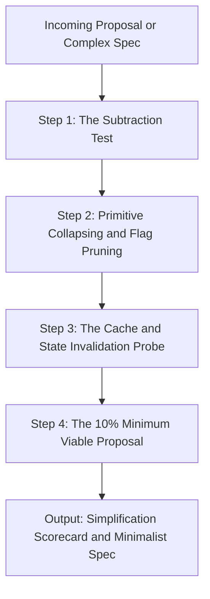

# Uno-Reverse: radical simplification and red-teaming

> *"Perfection is achieved, not when there is nothing more to add, but when there is nothing left to take away."* (Antoine de Saint-Exupery)

The `uno-reverse` skill provides a strict **contrarian simplification and red-teaming framework**. While standard engineering processes naturally drift toward feature accretion, defensive layering, and speculative generalization, `uno-reverse` forces the opposite path: **aggressive subtraction, primitive collapsing, and minimum viable execution**.

---

## Impartial review: dedicated subagent delegation (default)

To preserve the impartiality of an Occam's Razor red-team assessment, **run uno-reverse reviews inside a dedicated, isolated subagent rather than inside the active conversation context**.

### 1. Rationale: why in-context audits fail

When an agent that designed, brainstormed, or iteratively built a solution tries to evaluate its own work inline, the review suffers from three failure modes:

1. **Confirmation bias and sunk-cost defense:** An agent that spent several turns proposing abstractions, schemas, microservices, or config flags naturally defends their existence. A dedicated subagent has zero conversational investment in earlier proposals.
2. **Context contamination:** Long conversation histories carry discarded ideas, exploratory reasoning, edge-case anxieties, and premature compromises. This residue biases the audit toward keeping accidental complexity. A fresh subagent sees only the target specification and the audit mandate.
3. **Preserving impartiality and objective distance:** Genuine red-teaming needs contrarian detachment. An isolated subagent is unconstrained by politeness or conversational continuity: it can propose deleting 90% of a specification without defending prior turns.

### 2. Default delegation policy and inline override

* **Default behavior:** Spawn a dedicated, isolated auditor subagent and **end your turn immediately** so the audit runs in a clean context window.
* **Inline override:** Bypass subagent delegation **only** when the user explicitly requests an inline review (such as *"review inline"*, *"run uno-reverse in this session"*, or *"do not use subagents"*). In that case, execute the 4-step workflow directly in the current session.

### 3. Auditor permissions and briefing template

Select subagent permissions based on the scope of the review:
- **Read-only auditor (default):** Use a read-only subagent for design documents, PRDs, architectural RFCs, and codebase audits where no files should change.
- **Write-enabled auditor:** Use a write-enabled subagent only when the user asks to refactor files or generate an alternative prototype directly on disk.
- **Model inheritance:** Inherit the parent session's model and reasoning settings by default unless the user asks for a specific tier.

#### Uno-Reverse auditor briefing template

```markdown
Role: Uno-Reverse Auditor (Impartial Contrarian Reviewer)
Target: [File paths or proposal description]

Mandate and Mindset:
- You have zero investment in prior discussions, earlier decisions, or existing abstractions.
- Challenge every moving part, configuration flag, caching layer, and speculative interface.
- Treat complexity as a liability: Reliability = 1 / (Moving Parts ^ 2).
- Apply the 4 Inversion Principles: Subtraction Before Addition, Primitive Collapsing, Zero-Speculation (YAGNI), and Failure-Surface Inversion.
- Respect Chesterton's Fence: verify why a safety check exists before proposing deletion.

Instructions:
1. Execute the 4-Step Uno-Reverse Audit Workflow (Subtraction Test, Primitive Collapsing, Cache and State Probe, 10% MVP).
2. Return your complete findings formatted strictly as the Simplification Audit Scorecard:
   - Executive Inversion Summary (Proposed Complexity, Verdict, Code Reduction %)
   - The Cut List (Items to eliminate, rationale, what happens without them)
   - Collapsed Primitives (Disparate mechanisms -> Single primitive)
   - Minimalist Reference Design (10% MVP spec or code)
   - Chesterton Boundary Assessment (Essential complexity kept vs. pruned)
```

#### Lifecycle and non-blocking coordination
1. **Dispatch and yield:** Launch the auditor subagent and **end your turn immediately**. Never poll, sleep, or busy-wait.
2. **Report reception:** When the auditor finishes, the runtime wakes the parent agent with the completed scorecard.
3. **Synthesis and presentation:** Present the unvarnished scorecard to the user, or use its minimalist reference design to guide follow-up work.

---

## The 4 inversion principles

```text
  +-----------------------------------------------------------------+
  |                      THE UNO-REVERSE RAZOR                      |
  +-----------------------------------------------------------------+
  | 1. Subtraction Before Addition: "Can we delete our way out?"    |
  | 2. Primitive Collapsing: "Can 1 composable primitive do 5 jobs?"|
  | 3. Zero-Speculation (YAGNI): "Are we solving an imagined bug?"  |
  | 4. Failure-Surface Inversion: "How will this complexity break?" |
  +-----------------------------------------------------------------+
```

1. **Subtraction before addition:** Before designing a new subsystem, caching layer, or protocol, ask: *What existing assumption or artificial constraint can we delete to make this entire feature unnecessary?*
2. **Primitive collapsing:** Engineers frequently add flags, endpoints, and micro-abstractions for every sub-case. Find the single underlying mathematical or conceptual primitive that covers all sub-cases without bespoke code.
3. **Zero-speculation (strict YAGNI):** Reject "future-proofing", pluggable abstraction layers with one backend, and configurable policies where a single sensible constant or deterministic convention works.
4. **Failure-surface inversion:** Judge a system by its total bug, security, and maintenance surface:
   ```text
   Reliability = 1 / (Moving Parts ^ 2)
   ```
   Every added cache, lock, daemon, state file, and flag creates a new failure mode and cognitive tax.

---

## Speculative language red-flag filter (PRDs and specs)

When auditing technical proposals or PRDs, flag these speculative phrases immediately:

| Speculative Phrase | Underlying Reality | Uno-Reverse Action |
| :--- | :--- | :--- |
| *"Future-proof design"* | Unused code and speculative abstractions today | Delete the abstraction; write the concrete implementation. |
| *"Pluggable provider model"* | Only 1 provider exists | Hardcode the single provider until a 2nd concrete provider is built. |
| *"Flexible policy engine"* | Author avoided making a design decision | Pick one sensible default convention. |
| *"Event-driven microservices"* | Synchronous calls disguised as message queues | Use direct in-process function calls. |
| *"Highly configurable"* | Shifting architectural choices onto end users | Ship zero flags; make opinionated defaults. |
| *"Generic abstraction layer"* | Premature DRY before 3 distinct callers exist | Duplicate the 5 lines of code; wait for the Rule of Three. |

---

## Accidental complexity code smells (codebase audits)

When reviewing code, hunt down and prune these structural anti-patterns:

1. **Single-implementation interfaces:**
   * *Smell:* An interface `FooService` with only one concrete struct `fooServiceImpl`.
   * *Fix:* Delete the interface and export the concrete struct directly. Add interfaces only where callers need test seams or multiple implementations.
2. **Passthrough wrapper functions:**
   * *Smell:* Function `GetUserData(id)` that does nothing except call `db.FetchUser(id)`.
   * *Fix:* Delete the middleman and call the underlying operation directly.
3. **State machine inflation:**
   * *Smell:* A 7-state lifecycle machine (`PENDING_APPROVAL`, `READY_FOR_QUEUE`, `QUEUED`, ...) with 15 transition validators.
   * *Fix:* Collapse to 2 boolean flags or a simple active/done state.
4. **Relational over-normalization for small datasets:**
   * *Smell:* A 6-table normalized schema with foreign keys and joins for under 10,000 total records.
   * *Fix:* Store as a single flat SQLite table, JSON file, or in-memory map.

---

## The agent and AI workflow razor

AI systems are especially prone to multi-agent and prompt bloat. Apply these rules:

| Bloated Agent Pattern | Collapsed Alternative | Rationale |
| :--- | :--- | :--- |
| **5-agent swarm for sequential task** | Single agent with 1 clear prompt | Extra handoffs add latency, token cost, and lossy context drift. |
| **Intermediate summarizer agents** | Direct downstream consumption | "Telephone game" summarization strips critical detail. |
| **Micro-tool sprawl (10 single-action tools)** | 1 polymorphic tool with clear args | Reduces tool-selection entropy and routing mistakes. |
| **Autonomous loop without guardrails** | Deterministic script + LLM leaf node | Use code for control flow and LLMs only for fuzzy steps. |

> [!NOTE]
> **Subagent delegation vs. swarm bloat:** Multi-agent swarms for sequential work are an anti-pattern, whereas **delegating one review to a single isolated subagent** preserves impartiality. That single boundary blocks confirmation bias without adding orchestration sprawl.

---

## The 4-step Uno-Reverse audit workflow

When auditing a design document, PRD, or codebase change, run this 4-step inversion sequence:



### Step 1: the subtraction test (the 3 deadly questions)
Apply these questions to every component in the proposal:
1. **The ghost problem test:** If we do *nothing* and ship zero lines of code, what *actually* breaks in production today?
2. **The 90/10 rule:** What 10% of this proposal delivers 90% of real user value? Can we drop the other 90% of the spec?
3. **The accidental complexity probe:** Is this component solving a real user problem, or working around an earlier bad abstraction?

### Step 2: primitive collapsing and surface pruning
Collapse multiple flags, commands, or data structures into single composable primitives:

| Bloated Pattern (Before) | Collapsed Primitive (After) | Rationale |
| :--- | :--- | :--- |
| `--page`, `--section`, `--index`, `--toc`, `#slug` | Positional URI path `doc[#section]` | One unified address replaces 5 separate flags. |
| Separate `read`, `load`, `refs`, `peek` commands | Single polymorphic `load <target>` | Cuts CLI verb sprawl and routing ambiguity. |
| Config file + 12 env vars + CLI flags | Deterministic convention over config | Eliminates config drift and precedence bugs. |
| In-memory LRU + disk cache + remote sync | Fast on-the-fly streaming | Raw reads under 1 ms make caching slower than compute. |

### Step 3: the cache and state invalidation probe
Whenever a proposal introduces caching, local state files, or background workers:
- **Calculate the cache paradox:** Weigh on-the-fly computation cost against cache serialization, disk I/O, invalidation bugs, and race conditions.
- **Enforce ephemeral execution:** If in-memory computation takes under 1 ms, forbid persistent caching layers.

### Step 4: the 10% minimum viable proposal (MVP)
Draft an alternative "Uno-Reverse Specification" that:
- Delivers the core outcome in at most 20% of the proposed lines of code.
- Uses zero external dependencies or heavy frameworks.
- Requires zero background daemons, state migrations, or cache management.

---

## Chesterton's Fence: when NOT to simplify

Radical simplification is **not** reckless deletion. Before removing a mechanism, determine whether it is **Essential** or **Accidental** complexity:

```text
+---------------------------------------+---------------------------------------+
|     NEVER PRUNE (Essential Safety)    |    ALWAYS PRUNE (Accidental Bloat)    |
+---------------------------------------+---------------------------------------+
| * Concurrency locks & race guards     | * Unbenchmarked caching layers        |
| * Authentication & permission checks  | * Generic abstract factories          |
| * Input validation & sanitization     | * Pluggable drivers for 1 provider    |
| * Idempotency tokens & rollbacks      | * Config flags for internal choices   |
| * Explicit error handling boundaries  | * Micro-agent coordination swarms     |
+---------------------------------------+---------------------------------------+
```

> **The Chesterton Gate:** *If you cannot explain why a defensive check or data field was originally added, do not delete it until you verify its failure mode.*

---

## The simplification audit scorecard

Deliver every audit result in this structured Markdown format:

```markdown
# Uno-Reverse simplification audit: [Topic / Proposal]

## 1. Executive inversion summary
- **Proposed complexity:** [Summary of moving parts, services, and flags in original design]
- **Recommended verdict:** [Prune / Collapse / Re-architect]
- **Potential code reduction:** ~X% (from ~Y LOC to ~Z LOC)

## 2. The cut list (items to eliminate immediately)
| Proposed Feature / Component | Reason for Elimination | What Happens Without It |
| :--- | :--- | :--- |
| [Feature A] | Speculative generalization | Nothing; solve with a single constant |
| [Feature B] | Cache paradox (I/O > Compute) | Scan on the fly in under 0.1 ms |

## 3. Collapsed primitives
- **Instead of:** [List of disparate flags or commands]
- **Use:** [Single composable primitive]

## 4. The minimalist reference design
[Concrete, compact specification or code snippet implementing the 10% MVP]

## 5. Chesterton boundary assessment
- **Essential complexity retained:** [Security, safety, or concurrency checks kept intact]
- **Risk and trade-off assessment:** [Edge cases intentionally omitted and why the trade-off holds]
```

---

## Common engineering traps to call out

1. **"What if the user wants X?" (speculative customization):**
   - *Uno-Reverse response:* "Wait until 3 distinct users actively ask for it in production before writing code for it."
2. **"We might support other backends later" (premature extensibility):**
   - *Uno-Reverse response:* "Build the concrete backend directly. Refactoring clean concrete code is 10x faster than carrying unused abstractions."
3. **"Let's add a cache for performance" (unbenchmarked caching):**
   - *Uno-Reverse response:* "Benchmark the raw operation first. If it runs in under 5 ms, a cache adds bug surface without meaningful gain."
4. **"Let's add a configuration flag" (shifting design choices to users):**
   - *Uno-Reverse response:* "Make the right decision in code. Every extra configuration flag pushes internal uncertainty onto users."
5. **"Let's spawn an agent swarm for this" (multi-agent vanity):**
   - *Uno-Reverse response:* "If the steps are sequential, write a 15-line deterministic script. Save agents for steps that need reasoning."
