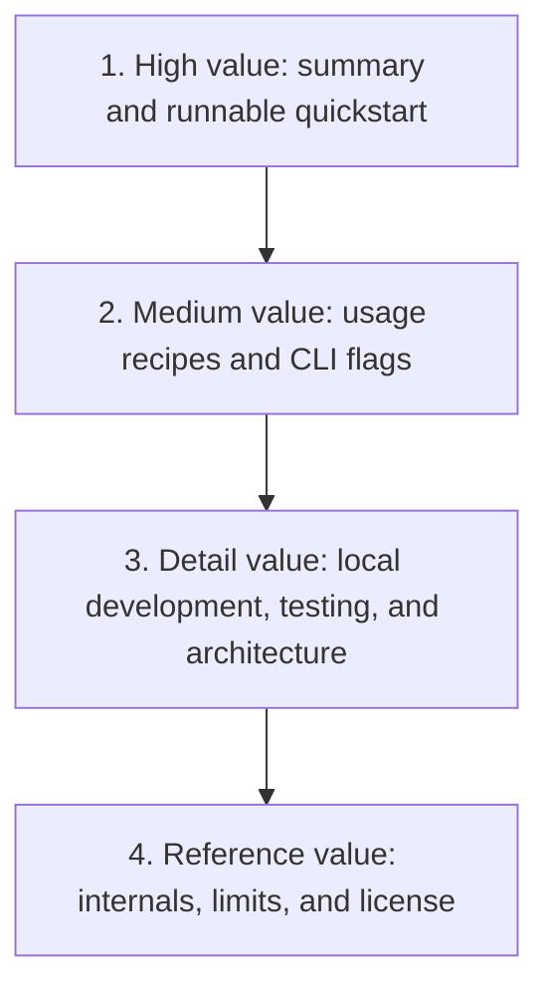

# Inverted pyramid documentation model

Organize technical articles, `README.md` files, API references, and developer guides by reader utility rather than author chronology. Put runnable value above the fold so readers get answers fast, then layer deeper details below.

---

## 1. Core model: information cascading

Structure every document from highest immediate utility at the top to deep reference details at the bottom:

### Three reader depths

Every technical document serves three distinct reading budgets:

1. **Scanner (`5s` to `10s`)**: Reads the one-line summary, copies the install and run commands, and tests the tool right away.
2. **Operator (`2m` to `5m`)**: Scans usage tables, CLI flags, configuration keys, and common task recipes.
3. **Contributor or architect (`10m+`)**: Studies module boundaries, local test commands, design trade-offs, and license terms.

---

## 2. Standard document hierarchies

### A. README and project documentation

Follow this sequence for user-facing repository documentation:

1. **Title and one-sentence summary**:
   - State what the project is, what problem it solves, and who uses it in a single active sentence.
2. **Immediate quickstart**:
   - Provide a copy-paste install command (`uv tool install ...`, `uv add ...`, `npx ...`, `go install ...`, or `cargo install ...`).
   - Show the single highest-value command that verifies setup and produces real output.
3. **Usage workflows and configuration**:
   - Present CLI flags, environment variables, and configuration keys in compact Markdown tables.
   - Show copy-paste recipes paired with expected terminal output.
4. **Development and testing**:
   - Show how to clone, build locally, run tests, and run linters.
5. **Architecture and internals**:
   - Explain subsystem boundaries, data schemas, and design trade-offs.
6. **License and compliance**:
   - List the SPDX license identifier, copyright notice, contributing guide, and security policy.

---

### B. Technical articles and blog posts

1. **Outcome lead (first `150` words)**:
   - Open with the core result, benchmark change, or direct answer.
   - Skip throat-clearing preambles about how fast modern software changes.
2. **Working example above the second scroll**:
   - Show a runnable code snippet, terminal session, or system diagram before diving into theory.
3. **Implementation breakdown and trade-offs**:
   - Walk through the key steps, failure modes, configuration choices, and measured benchmarks.
4. **Concrete next steps**:
   - Close with runnable follow-up commands, repository links, and primary references.

---

## 3. Editorial and structural rules

- **Zero silent edits on existing drafts**: When auditing or refactoring an existing `README.md` or article, propose a numbered list of structural moves and wait for user approval before rewriting user prose on disk, unless the user explicitly asks to rewrite the file directly.
- **Preserve author voice**: Reorder sections without stripping the author's tone, contractions, or natural idioms into stiff corporate phrasing.
- **Lead with runnable action**: Never bury install or quickstart commands behind architectural history. Let the reader run the tool first.
- **Sentence-case headings**: Write concise sentence-case headings that lead with concrete nouns or active verbs.
- **Tables over loose lists**: Use Markdown tables for CLI flags, configuration keys, and option comparisons.
- **Clean punctuation without em dashes**: Break clauses with periods, commas, or colons. Never use mid-sentence em dashes, en dashes, or spaced double hyphens.
