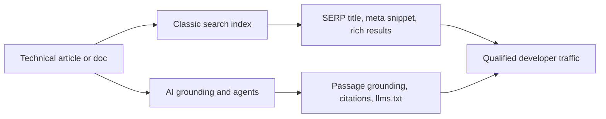

# SEO and generative engine optimizer

Optimize developer documentation, static sites, and engineering blogs for classic web search and AI grounding engines (`Google AI Overviews`, `ChatGPT Search`, `Perplexity`, `Claude`), anchored in Google Search Central specifications.

---

## 1. Reference routing and operating modes

Load only the reference guides needed for the active task:

- **Google Search GenAI rules**: Read [references/google_search_genai_guidelines.md](references/google_search_genai_guidelines.md) for `AI Overviews`, RAG grounding, query fan-out, non-commodity content, and `IPTC` AI image metadata.
- **Meta tags and `robots` directives**: Read [references/meta_tags_and_robots_spec.md](references/meta_tags_and_robots_spec.md) for supported `<meta>` tags, `nosnippet`, `max-snippet`, `max-image-preview:large`, `data-nosnippet`, and `X-Robots-Tag` headers.
- **AI search, crawlers, and `llms.txt`**: Read [references/geo_and_ai_search.md](references/geo_and_ai_search.md) for the AI crawler `robots.txt` matrix (`Google-Extended`, `OAI-SearchBot`, `GPTBot`, `ClaudeBot`, `PerplexityBot`), direct-answer blocks, `/llms.txt`, and `/llms-full.txt`.
- **Multilingual and `hreflang` SEO**: Read [references/multilingual_international_seo.md](references/multilingual_international_seo.md) for reciprocal `hreflang` clusters, ISO locale codes, and avoiding IP auto-redirects.
- **Technical SEO checklist**: Read [references/technical_seo_checklist.md](references/technical_seo_checklist.md) for `<head>` hygiene, heading order, link `rel` attributes (`sponsored`, `ugc`, `nofollow`), and Core Web Vitals.
- **Frontmatter and taxonomy**: Read [references/frontmatter_standards.md](references/frontmatter_standards.md) for splitting `summary` from `description` and formatting `kebab-case` tags.
- **Schema.org JSON-LD**: Read [references/schema_markup_guide.md](references/schema_markup_guide.md) for `TechArticle`, `SoftwareApplication`, `WebSite`, `ProfilePage`, and `BreadcrumbList` graphs.
- **Migrations and HTTP status codes**: Read [references/site_migrations_and_status_codes.md](references/site_migrations_and_status_codes.md) for `301` vs. `410` handling, soft-`404` fixes, domain moves, and crawl budget.
- **SERP features and Discover**: Read [references/search_appearance_and_serp_features.md](references/search_appearance_and_serp_features.md) for site names, `48px` site icons, featured snippets, date parity, and Google Discover hero images.
- **Evergreen content refreshes**: Read [references/content_refresh_guide.md](references/content_refresh_guide.md) for diagnosing impression decay with weighted Search Console SQL and fixing query cannibalization.

### Operating rule: zero silent edits

When auditing an existing Markdown post, frontmatter block, or HTML template, never overwrite files on disk silently. Run `uv run scripts/audit_seo.py`, present the findings and proposed metadata or structural edits (using [assets/seo_audit_template.md](assets/seo_audit_template.md) when helpful), and wait for explicit user approval before modifying files.

---

## 2. Core SEO and GEO principles



1. **Information gain over commodity summaries**: Search rankings and AI citations reward original benchmarks, real post-mortems, runnable code, and architecture diagrams. Generic summaries get filtered out.
2. **Inverted pyramid lead**: Answer the core technical query inside the first `150` words before walking through background or edge cases.
3. **Dual metadata split (`summary` vs. `description`)**:
   - **`summary` (for human readers, `80` to `180` chars)**: Editorial hook shown on homepage feeds, category pages, and article cards.
   - **`description` (for search and AI snippets, `120` to `160` chars)**: Factual, keyword-grounded direct answer rendered in `<meta name="description">`, Open Graph tags, and JSON-LD `description`. Never duplicate `summary` verbatim, and skip `<meta name="keywords">` (ignored by Google).

---

## 3. Five-stage optimization workflow

### Stage 1: Search intent and query grounding
Identify whether the target query is **informational** (concept explanation), **procedural** (step-by-step build), or **diagnostic** (error fix), and verify the page answers that exact query directly.

### Stage 2: Frontmatter and taxonomy split
Craft distinct `title`, `summary`, and `description` fields with clean taxonomy:
```yaml
---
title: "Building an MCP Server in Go with Gemini 4"
summary: "Turn any Go CLI into a typed tool server for AI agents in 50 lines of code."
description: "Step-by-step guide to building a Model Context Protocol (MCP) server in Go. Covers JSON-RPC handlers, schema validation, and stdio transport."
categories: ["Software Engineering"]
tags: ["apis", "golang", "mcp", "tutorial"]
---
```
- **Title**: `40` to `60` characters, front-loading the primary technical entity.
- **Tags**: Sorted alphabetically, lowercase `kebab-case`, with one primary category and zero category duplication.

### Stage 3: Quotable structure
- Place a `1` to `2` sentence direct-answer definition immediately below primary `H2` question headings.
- Use Markdown tables for feature or benchmark comparisons and fenced code blocks with language identifiers.
- Break sentences cleanly without mid-sentence em dashes or en dashes.

### Stage 4: Technical HTML, links, and JSON-LD
- Render a single `H1` per page (usually via template title) and nest `H2` -> `H3` -> `H4` sequentially without skipping levels.
- Write `30` to `100` character descriptive `alt` text on every diagram and screenshot.
- Add `2` to `4` internal links with descriptive anchor text (never *"click here"* or *"link"*), and qualify paid or user-submitted outbound links with `rel="sponsored"` or `rel="ugc"`.
- Emit valid `TechArticle` and `BreadcrumbList` JSON-LD matching visible page dates and authorship.

### Stage 5: Automated validation
Run the bundled scripts below and resolve every reported `ERROR` or `WARNING` before release.

---

## 4. Validation rules and pitfalls

> [!WARNING]
> **High-frequency SEO and GEO pitfalls:**
> 1. **Blocking `Googlebot` vs. `Google-Extended`**: Disallowing a page in `robots.txt` hides `noindex` tags from `Googlebot`, while blocking `Google-Extended` opts out of Gemini training without blocking Google Search or `AI Overviews` (use `nosnippet` or `data-nosnippet` on `<span>`, `<div>`, or `<section>` to restrict snippet extraction).
> 2. **Identical `summary` and `description`**: Reusing one string hurts either feed click-throughs or search snippet density.
> 3. **Generic `alt` or anchor text**: Labels like `diagram`, `screenshot`, or `[here](...)` lose image search relevance and passage meaning.
> 4. **Artificial `lastmod` bumps**: Updating `dateModified` or sitemap `<lastmod>` without substantive content edits causes Google to ignore freshness signals.

---

## Available scripts

Run companion tools with `uv run` (zero external Python dependencies required):

- **`scripts/audit_seo.py`**: Audits a Markdown file or directory for title/description/summary lengths, taxonomy sorting, heading hierarchy, image `alt` text, link anchors, slop terms, and `data-nosnippet` HTML rules (ignoring fenced code blocks).
  ```bash
  uv run scripts/audit_seo.py content/posts/my-article/index.md
  uv run scripts/audit_seo.py content/posts --json --quiet
  ```
- **`scripts/generate_llmstxt.py`**: Generates a spec-compliant `/llms.txt` index (and optional `/llms-full.txt` bundle) from page-bundle (`**/index.md`) and flat (`**/*.md`) posts, using [assets/llms_txt_template.txt](assets/llms_txt_template.txt) conventions.
  ```bash
  uv run scripts/generate_llmstxt.py --content-dir content/posts --base-url https://example.com --output static/llms.txt
  uv run scripts/generate_llmstxt.py --content-dir content/docs --url-prefix docs --base-url https://example.com --output static/llms.txt --llms-full static/llms-full.txt
  ```
