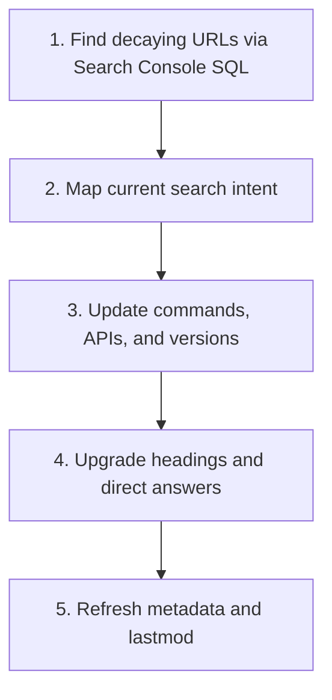

# Evergreen content refresh and decay mitigation guide

Systematic procedure for diagnosing organic search decay, refreshing legacy high-value articles, and resolving keyword cannibalization.

---

## 1. Diagnosing content decay

Technical articles decay over `6` to `18` months as CLI names change, APIs ship breaking releases, and SDK patterns evolve.

### Warning signals in Search Analytics
- **Impression cliff**: Search impressions drop `> 40%` over `90` days.
- **Position slip**: Impression-weighted average rank drops from top `3` to positions `8` to `15`.
- **CTR decay**: High impressions with falling CTR caused by stale version years or deprecated SDK names in titles.

---

## 2. Five-step content refresh workflow



### Step 1: Identify targets with weighted position SQL
Never average raw Search Console `position` rows without impression weighting; calculate `weighted_avg_pos`:

```sql
SELECT
  page,
  SUM(clicks) AS clicks,
  SUM(impressions) AS impressions,
  ROUND(SUM(position * impressions) * 1.0 / NULLIF(SUM(impressions), 0), 2) AS weighted_avg_pos
FROM search_performance
WHERE date >= date('now', '-90 days')
GROUP BY page
ORDER BY clicks DESC;
```

### Step 2: Map current search intent
Check how developer queries shifted:
- Are readers searching for current runtimes and models (`Go 1.27`, `Gemini 4`, current Gen AI SDKs)?
- Has community terminology evolved since original publication?

### Step 3: Update technical commands and code snippets
- Replace deprecated flags, retired models, and unmaintained packages.
- Re-run every code example against current stable toolchains.
- Add clear callout blocks (`> [!NOTE]`) for breaking changes.

### Step 4: Upgrade headings and direct answers
- Make every `H2` descriptive and task-oriented.
- Place a `1` to `2` sentence bolded direct answer right under the first major conceptual heading.
- Add a comparison table contrasting legacy patterns with the current approach.

### Step 5: Refresh metadata honestly
- Update `title` if search terminology changed.
- Keep `summary` (human hook) distinct from `description` (factual search snippet).
- Update `lastmod` or `dateModified` only after making substantive technical revisions.

---

## 3. Resolving keyword cannibalization

**Keyword cannibalization** happens when multiple pages on your domain compete for identical search queries, splitting ranking authority.

### Resolution options
1. **Differentiate and cross-link**: Focus Article A on core concepts and Article B on production architecture, linking between them with descriptive anchors.
2. **Consolidate with `301` redirects**: Merge thin overlapping posts into one canonical guide and `301`-redirect retired slugs to the kept URL.
3. **Canonical pointing**: Add `<link rel="canonical">` when intentionally keeping a secondary variant indexed under a primary guide.
